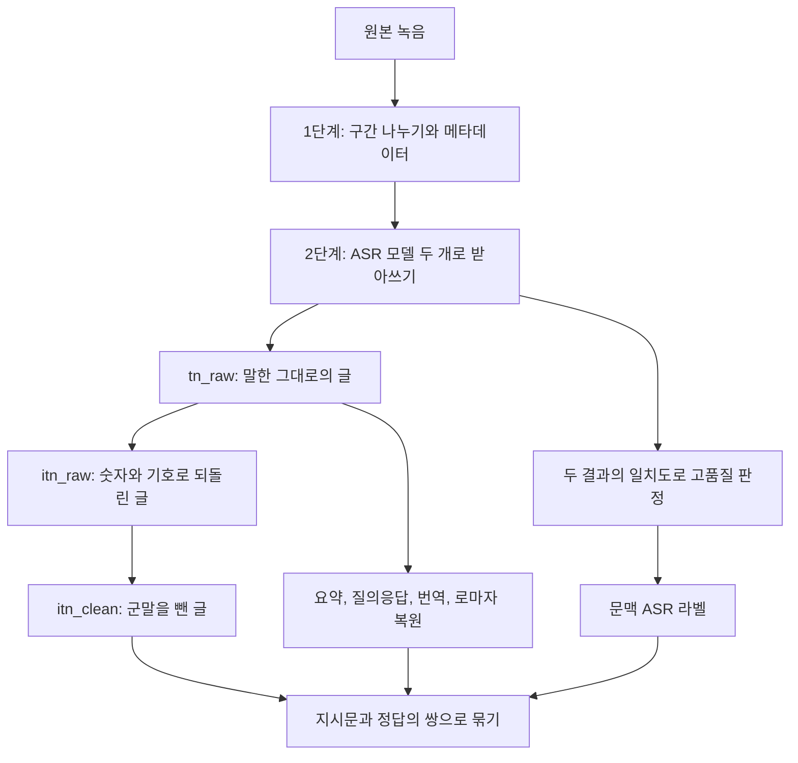

# 음성 AI 새 논문 2026-11-26 (목요일)
- **오늘의 논문**: 6편 (ASR 2편, SpeechLLM 2편, Speech Foundation Model 2편)
- **먼저 볼 것**: Induction Head Origins of SLAM-ASR Speech Recognition Models (얼린 LLM에 작은 연결 층만 붙여도 ASR이 되는 이유를 LLM 안의 특정 어텐션 헤드로 짚어 낸 논문이라, LLM 기반 ASR을 다루는 사람에게 구조를 보는 눈을 준다고 판단했습니다.)

| 번호 | 분야 | 논문 | 한 줄 요약 |
|---|---|---|---|
| 1 | ASR, 다화자 인식 | [Beyond Mimicry: Constrained Exploration with GRPO for Joint Multi-Talker ASR and Diarization under Unknown Speaker Counts](https://arxiv.org/abs/2611.22627) | 여러 사람이 겹쳐 말한 음성을 누가, 언제, 무엇을 말했는지까지 받아쓰는 모델을, 정답을 따라 쓰게 한 뒤 스스로 써 본 결과에 점수를 매겨 한 번 더 학습시켰습니다. |
| 2 | ASR, 다국어 데이터 구축 | [Granary-v2: Scalable Multilingual Speech Data Curation for Predictable and Controllable Model Outputs](https://arxiv.org/abs/2611.28248) | 같은 녹음에 말한 그대로의 글, 숫자를 기호로 바꾼 글, 군말을 뺀 글, 번역을 함께 붙인 48개 언어 약 84만 시간의 학습 데이터와 그 제작 도구를 내놓았습니다. |
| 3 | SpeechLLM, 내부 동작 분석 | [Induction Head Origins of SLAM-ASR Speech Recognition Models](https://arxiv.org/abs/2611.24721) | 얼린 LLM에 작은 연결 층만 붙여도 음성 인식이 되는 까닭이, 글에서 반복되는 낱말을 베껴 쓰던 LLM 안의 부품이 음성을 읽는 데 그대로 쓰이기 때문임을 보였습니다. |
| 4 | SpeechLLM, 답변 거부 평가 | [Can Speech LLMs Recognize When Audio Evidence Is Insufficient? A Diagnostic Study and a Pre-Generation Probing Mitigation](https://arxiv.org/abs/2611.29393) | 녹음에 답이 없는 질문에 음성 LLM이 답을 지어내는지를 쟀더니, 합성 음성으로 얻은 결론이 사람이 읽은 음성에서는 뒤집혔습니다. |
| 5 | Speech Foundation Model, 표현 분석 | [What Do Multilingual Self-Supervised Speech Encoders Know About Sentence Meaning?](https://arxiv.org/abs/2611.17686) | 글 없이 음성만으로 학습한 다국어 모델 안에 문장의 뜻이 얼마나 들어 있는지를 76개 언어에서 쟀습니다. |
| 6 | Speech Foundation Model, 음성 코덱 | [UMelCodec: An Ultra-Low-Bitrate and Lightweight Mel-Domain Neural Speech Codec](https://arxiv.org/abs/2611.25569) | 음성을 1초에 325비트로 줄였다가 되살리는 작고 빠른 압축 모델을, 큰 사전학습 모델의 도움 없이 만들었습니다. |

## ASR

### 1. Beyond Mimicry: Constrained Exploration with GRPO for Joint Multi-Talker ASR and Diarization under Unknown Speaker Counts
Yunrui Cai 외 5명(홍콩중문대, 칭화대 선전국제대학원), 2026-11-17 제출, arXiv Comments 항목에 Interspeech 2026으로 표기. [논문](https://arxiv.org/abs/2611.22627), [코드](https://github.com/caiyunrui/MT-GRPO)

- **분야**: ASR, 다화자 인식
- **한 줄 요약**: 여러 사람이 겹쳐 말한 음성을 누가, 언제, 무엇을 말했는지까지 받아쓰는 모델을, 정답을 따라 쓰게 한 뒤 스스로 써 본 결과에 점수를 매겨 한 번 더 학습시켰습니다.
- **이 논문 전에는**: 겹친 음성을 SpeechLLM으로 받아쓰려면 정답 문장을 따라 쓰게 하는 지도 미세조정을 합니다. 논문은 이것을 SFT라고 부릅니다. 그런데 화자 수를 모르는 채로 말이 많이 겹치면, SFT만 한 모델은 없는 말을 길게 지어내거나 화자 표시와 시간 표시를 틀린 꼴로 냅니다. 학습할 때는 항상 정답 앞부분을 보고 다음 토큰을 맞히기 때문에, 자기가 잘못 쓴 출력에서 회복하는 법을 배우지 못합니다.
- **핵심 아이디어**:
  - 1단계에서는 SFT를 하되, 출력의 맨 앞에 화자 수를 먼저 적게 합니다. 논문은 이 앞머리를 CoT 접두라고 부릅니다.
  - 2단계에서는 GRPO라는 강화학습을 합니다. 같은 음성에 대해 모델이 출력을 8개 뽑고, 그중 평균보다 점수가 높은 출력이 더 잘 나오도록 모델을 고칩니다.
  - 점수는 다섯 가지를 더해 만듭니다. 화자 수를 맞혔는지, 화자 순서를 무시한 WER이 낮은지, 시간이 맞는지, 연속으로 틀린 낱말이 길지 않은지, 출력의 꼴이 맞는지입니다.
  - WER처럼 미분할 수 없는 평가 지표를 학습 목표로 직접 쓸 수 있다는 점이 SFT와 다릅니다.
- **어떻게 확인했나**: Qwen2.5-Omni-7B에 LoRA를 붙여, LibriSpeech 발화를 섞어 만든 Libri2Mix와 Libri3Mix, 그리고 두 세트를 섞어 화자 수를 알 수 없게 한 Dynamic-Mix에서 평가했습니다. Dynamic-Mix에서 cpWER이 SFT와 CoT만 썼을 때의 20.17%에서 9.24%로 내려갔고, 화자 수를 맞힌 비율은 90.06%에서 99.72%로 올랐습니다. cpWER은 화자 순서를 가장 유리하게 맞춘 뒤 잰 WER입니다.
- **볼 만한 점**: 강화학습으로 LLM 기반 ASR을 후처리 학습하는 흐름이 다화자 인식과 화자 구분으로 넓어진 사례이고, 보상 항목을 하나씩 뺀 실험이 있어서 무엇이 효과를 냈는지 볼 수 있다고 판단했습니다. "자세히"에서는 GRPO의 동작과 다섯 가지 보상의 계산식을 설명합니다.

자세히: 출력 형식, GRPO의 학습 방식, 다섯 가지 보상의 계산

- **미리 알아둘 것**:
  - cpWER: 화자별로 인식 결과를 이어 붙인 뒤, 예측 화자와 정답 화자를 짝짓는 모든 경우 중 WER이 가장 낮은 값을 고릅니다. 모델이 붙인 화자 번호가 정답의 번호와 달라도 불이익이 없습니다.
  - WDER: 낱말은 맞게 받아썼는데 화자를 틀리게 붙인 비율입니다. 프레임 단위로 재는 DER과 달리 낱말 단위로 잽니다. 논문은 LLM이 프레임이 아니라 토큰을 내기 때문에 이 지표를 썼다고 설명합니다.
  - TE: 예측한 시작, 끝 시각과 정답 시각의 평균 절대 차이입니다. 단위는 초입니다.
  - GRPO: Group Relative Policy Optimization의 줄임말입니다. 보상의 기준선을 따로 학습한 가치 모델이 아니라, 같은 입력에서 뽑은 출력 묶음의 평균으로 잡는 강화학습 방법입니다. ASR에 빗대면 N-best 가설의 평균 오류를 기준으로 삼는 MWER 학습과 닮았습니다. 이 비유는 설명을 위한 것입니다.
  - 이 논문의 화자 구분 범위: 긴 회의 녹음의 화자 구분이 아닙니다. 많이 겹친 짧은 발화에서 화자별 받아쓰기와 구간 경계를 맞히는 일을 뜻한다고 각주 2에 적혀 있습니다.
- **원리**:
  - 출력 형식: 맨 앞에 화자 수를 적은 CoT 접두가 옵니다. 그 뒤로 화자마다 여는 화자 표시, 시작 시각, 끝 시각, 받아쓴 글, 닫는 화자 표시가 이어집니다.
  - 모델: 오디오 인코더, 연결 층, LLM의 모든 선형 층에 LoRA를 붙였습니다. 랭크는 16입니다. LLM에만 붙이지 않은 이유는, 겹친 소리를 풀어내는 일이 인코더 쪽에서 일어나야 하기 때문이라고 논문은 설명합니다.
  - 1단계 SFT: 정답에서 화자의 순서를 무작위로 섞어 학습합니다. 모델이 화자 순서의 버릇이 아니라 소리를 근거로 쓰게 하려는 것입니다. 5 에폭 학습합니다.
  - 2단계 GRPO: 음성 하나에 대해 지금의 모델이 출력 8개를 뽑습니다. 출력마다 보상을 계산하고, 묶음의 평균을 빼고 표준편차로 나눠 어드밴티지를 구합니다. 어드밴티지가 큰 출력의 확률이 커지도록 모델을 갱신합니다.
  - 안전장치: 갱신 폭은 확률비를 1에서 0.2 이내로 잘라 제한합니다. 또 SFT를 마친 모델과의 KL 발산에 0.04의 가중치를 걸어, SFT에서 배운 형식과 언어 능력에서 멀어지지 않게 합니다.
  - 학습 데이터: GRPO에는 공식 학습 세트에서 많이 겹친 발화 10,000개만 골라 씁니다.
  - 보상 다섯 가지는 같은 가중치로 더합니다.
    - 화자 수 보상: 접두에 적은 화자 수가 정답과 같으면 1.0을 줍니다.
    - 의미 보상: 화자 순서를 무시한 WER을 구해 exp(-WER)로 바꿉니다. 오류가 아무리 커도 보상이 0과 1 사이에 머뭅니다.
    - 시간 보상: 위에서 찾은 가장 좋은 화자 짝을 기준으로 시간 오차를 구합니다. 0.2초까지는 봐주고, 넘는 만큼 보상을 줄입니다.
    - 연속 오류 벌점: 삽입과 대체 오류가 연달아 나온 가장 긴 길이를 잽니다. 2를 넘으면 넘는 만큼 벌점을 줍니다. 띄엄띄엄 틀린 것과 한 곳에서 길게 지어낸 것을 WER은 똑같이 세기 때문에 따로 둔 항목입니다.
    - 형식 벌점: 표시가 빠졌거나, 표시 밖에 말을 덧붙였거나, 시작 시각이 끝 시각보다 늦으면 벌점을 줍니다. 접두에는 3명이라고 쓰고 화자 표시는 2개만 낸 경우에는 큰 벌점을 줍니다.

- **예시로 따라가기**: 아래는 설명을 위해 만든 예이고, 논문의 실제 출력이 아닙니다.
  - 세 사람이 겹쳐 말한 6초짜리 음성이 들어옵니다.
  - 출력 A는 접두에 3명이라고 쓰고, 세 화자의 구간과 글을 거의 맞게 냅니다. 화자 수 보상 1.0을 받고, 의미 보상과 시간 보상도 높습니다.
  - 출력 B는 접두에 2명이라고 쓰고 두 화자만 받아씁니다. 화자 수 보상이 없고, 한 사람의 말이 통째로 빠져 의미 보상도 낮습니다.
  - 출력 C는 3명이라고 썼지만 둘째 화자의 글에서 없는 낱말을 여섯 개 연달아 지어냅니다. 연속 오류 벌점을 받습니다.
  - 8개 출력의 평균 보상보다 A는 높고 B와 C는 낮습니다. 그래서 A와 같은 출력의 확률이 커지고, B와 C와 같은 출력의 확률은 작아집니다.
- **결과 더 보기**:
  - Libri3Mix에서는 cpWER이 22.45%에서 14.52%로, WDER이 4.03%에서 1.95%로 내려갔습니다. Libri2Mix에서는 5.83%에서 4.45%로 내려가 개선 폭이 작습니다.
  - 아무 학습도 하지 않은 Qwen2.5-Omni-7B는 Dynamic-Mix에서 화자 수를 32.25%만 맞혔습니다.
  - 보상을 하나씩 뺀 실험에서는 화자 수 보상을 뺐을 때 cpWER이 18.02%로 가장 크게 나빠졌습니다. 화자 순서를 무시하는 계산을 뺐을 때가 16.56%, 연속 오류 벌점을 뺐을 때가 11.84%였습니다. 시간 보상과 형식 벌점은 빼도 9.66%, 9.85%로 차이가 작았습니다.
  - 다른 방법과의 비교표에서 이 모델이 항상 1등은 아닙니다. Libri2Mix에서는 SOP-LLM이 3.6으로 더 낮고, Libri3Mix에서는 GEncSep이 13.1로 더 낮습니다. 논문은 별도의 음성 분리 부품이나 VAD 없이 비슷한 수준에 닿았다는 점을 내세웁니다.
- **한계**: 한계를 다룬 절은 따로 없습니다. 4절 결론에서 저자들은 실험이 LibriMix라는 합성 혼합 데이터에 한정돼 있고, AMI나 AliMeeting 같은 실제 회의 데이터로 넓히는 일은 앞으로의 과제라고 적었습니다.

### 2. Granary-v2: Scalable Multilingual Speech Data Curation for Predictable and Controllable Model Outputs
Nithin Rao Koluguri 외 19명(NVIDIA), 2026-11-20 제출, 프리프린트. [논문](https://arxiv.org/abs/2611.28248), [데이터](https://huggingface.co/datasets/nvidia/Granary-v2), [코드](https://github.com/NVIDIA-NeMo/Curator/tree/main/tutorials/audio/granary_v2)

- **분야**: ASR, 다국어 데이터 구축
- **한 줄 요약**: 같은 녹음에 말한 그대로의 글, 숫자를 기호로 바꾼 글, 군말을 뺀 글, 번역을 함께 붙인 48개 언어 약 84만 시간의 학습 데이터와 그 제작 도구를 내놓았습니다.
- **이 논문 전에는**: 음성 말뭉치는 대개 녹음 하나에 전사문 하나만 붙어 있고, 말뭉치마다 전사 규칙이 다릅니다. 받아쓰기 앱은 숫자를 아라비아 숫자로 쓰고 군말을 빼기를 원하고, 언어 분석용 전사는 말한 그대로를 원합니다. 지시문으로 출력 형태를 고르는 모델을 학습시키려면 같은 녹음에 여러 형태의 정답이 붙어 있어야 하는데, 그런 데이터가 없었습니다.
- **핵심 아이디어**:
  - 먼저 말한 그대로의 전사문을 하나 만듭니다. 숫자를 말로 풀어 쓰고, 군말, 반복, 말을 고쳐 시작한 부분을 그대로 둔 글입니다.
  - 나머지 형태는 모두 이 전사문에서 텍스트 LLM으로 만들어 냅니다. 숫자를 기호로 되돌린 글, 거기서 군말을 뺀 글, 다른 문자로 적힌 영어 낱말을 로마자로 되돌린 글, 요약, 질의응답, 번역이 여기에 해당합니다.
  - 전사문 자체는 언어마다 다른 ASR 모델 두 개로 만들고, 두 결과가 거의 일치할 때만 고품질 표시를 붙입니다.
  - 마지막에 "지시문과 정답"의 쌍으로 묶어, 같은 녹음이 여러 과제의 학습 예제가 되게 합니다.
- **어떻게 확인했나**: 인코더 약 6억 파라미터의 영어 Transformer-TDT 모델 두 개를 같은 30만 스텝 동안 학습시켰습니다. 하나는 영어 학습 데이터 전체인 347,178.90시간을 썼고, 다른 하나는 고품질 표시가 붙은 162,845.95시간만 썼습니다. 9개 평가 세트의 평균 WER이 전체를 썼을 때 4.91%, 고품질만 썼을 때 4.67%였습니다.
- **볼 만한 점**: 대규모 의사 라벨 데이터를 만드는 절차와 걸러 내는 기준이 숫자까지 공개돼 있어, 자체 데이터를 만드는 사람이 참고할 수 있다고 판단했습니다. "자세히"에서는 세 단계 처리 과정과 고품질 판정 규칙을 설명합니다.

자세히: 세 단계 처리 과정, 여러 형태의 정답을 만드는 순서, 고품질 판정 규칙

- **미리 알아둘 것**:
  - TN과 ITN: TN(text normalization)은 "$25"를 "twenty five dollars"처럼 말하는 꼴로 푸는 일입니다. ITN(inverse text normalization)은 그 반대로, 말하는 꼴을 숫자와 기호로 되돌리는 일입니다.
  - 군말과 말 고침: 논문은 "uh" 같은 채움말, 낱말 반복, 말을 하다 고쳐 시작한 부분을 묶어 disfluency라고 부릅니다. 이 리포트에서는 군말이라고 적겠습니다.
  - 문맥 ASR: 인식할 때 이름이나 전문 용어 목록을 힌트로 함께 주는 설정입니다. 핫워드 편향과 같은 목적입니다.
  - TDT: Token-and-Duration Transducer의 줄임말입니다. RNN-T가 토큰과 함께 그 토큰이 차지하는 프레임 수도 예측하게 한 변형입니다.
  - Granary-v1: 같은 그룹이 먼저 낸 25개 언어 데이터입니다. v2는 언어를 48개로 늘리고, 녹음마다 여러 형태의 정답을 붙였습니다.
- **원리**: 처리 과정은 세 개의 독립된 파이프라인으로 나뉩니다. 이미 짧게 잘린 음성은 첫 단계를 건너뛸 수 있습니다.
  - 1단계, 메타데이터 추출:
    - 긴 녹음 전체에 화자 구분 모델을 돌려 화자별 시간표를 저장합니다.
    - Silero VAD로 0.5초에서 40초 사이의 구간으로 자릅니다.
    - 구간마다 화자 수, 소리 종류, 언어 예측을 붙입니다. 소리 종류는 음성인지 음악인지 등을 뜻합니다.
  - 2단계, ASR 라벨링:
    - 믿을 만한 전사문이 없는 음성은 주 모델과 보조 모델 두 개로 받아씁니다. 언어에 따라 모델 조합이 다릅니다. 예를 들어 15개 언어는 Qwen3-Omni와 Qwen3-ASR을, 8개 언어는 Parakeet v3와 Whisper를 씁니다.
    - 기본으로 주 모델의 결과를 고릅니다. 주 모델의 결과가 알려진 환각 문구 규칙에 걸리면 보조 모델의 결과를 씁니다.
    - 사람이 쓴 전사문이 있는 음성은, 지원하는 언어에 한해 Qwen3-Omni가 음성을 들으며 그 전사문을 말한 그대로의 꼴로 고칩니다.
  - 3단계, 텍스트 라벨 생성: 텍스트 LLM이 아래 순서로 필드를 만듭니다. 인도계 언어에는 Gemma 계열을, 나머지에는 Qwen 계열 모델을 썼습니다.
    - pnc_text: 낱말과 순서는 그대로 두고 문장부호와 대소문자만 고친 글입니다.
    - tn_raw: 숫자, 날짜, 화폐, 단위를 말하는 꼴로 풀고 군말을 그대로 둔 글입니다. 다른 필드의 출발점입니다.
    - itn_raw: tn_raw에서 숫자와 기호만 쓰는 꼴로 되돌린 글입니다. 군말은 남아 있습니다.
    - itn_clean: itn_raw에서 군말을 뺀 글입니다. 낱말 수가 지나치게 줄면 원래 글로 되돌립니다.
    - code_switched_text: 다른 문자로 소리 나는 대로 적힌 영어 낱말을 로마자 철자로 되돌린 글입니다.
    - captioning_text와 speech_qa_text: 전사문을 요약한 글과, 전사문으로 답할 수 있는 질문과 답 한 쌍입니다.
  - 고품질 판정: CPU에서 규칙으로 처리합니다.
    - 구조 검사: 초당 글자 수가 4에서 30 사이인지 봅니다. 중국어, 일본어, 한국어, 광둥어는 하한이 1.5입니다. 글 첫머리에 알려진 환각 문구가 있는지, 말하는 꼴의 글에 아라비아 숫자가 남아 있는지도 봅니다.
    - 일치 검사: 새로 만든 라벨은 주 모델의 결과를 기준으로 보조 모델 결과의 오류율을 잽니다. 사람 전사문이 있으면 그것을 기준으로 주 모델의 결과를 잽니다.
    - 통과 기준: 글자 단위로 재는 언어는 CER 0.05 이하입니다. 낱말 단위로 재는 언어는 WER 0.01 이하입니다. ITN이 글을 바꾼 경우에는 WER이 같은 말뭉치, 같은 언어 묶음의 평균보다 0.01 넘게 높지 않으면 통과입니다.
  - 고품질 레코드에만 하는 일: 문맥 ASR용 라벨을 만듭니다. LLM이 전사문에서 분야, 개체 이름, 용어를 뽑고, 그럴듯하지만 관계없는 낱말도 방해용으로 만듭니다. 힌트가 불완전하거나 엉뚱해도 정답 전사문은 음성 그대로입니다.
  - 번역: Qwen 계열의 더 큰 모델로 번역하고, 참조 번역 없이 품질을 추정하는 Cometoid 점수를 함께 저장합니다. 학습할 때 이 점수로 걸러 쓸 수 있습니다.
  - 지시문 묶기: 위 필드들을 "지시문, 정답 글, 과제와 언어 표시"의 쌍으로 묶습니다.

- **예시로 따라가기**: 아래 문장은 설명을 위해 만든 것이고, 공개된 레코드가 아닙니다.
  - 화자가 "uh I I paid twenty five dollars"라고 말했다고 합시다.
  - tn_raw는 "uh I I paid twenty five dollars"입니다. 숫자가 말로 적혀 있고 군말과 반복이 남아 있습니다.
  - itn_raw는 "uh I I paid $25"입니다. 숫자만 기호로 바뀌었습니다.
  - itn_clean은 "I paid $25."입니다. 군말과 반복이 빠졌습니다.
  - 지시문이 "말한 그대로 받아쓰라"이면 정답은 tn_raw이고, "군말을 빼고 숫자로 쓰라"이면 정답은 itn_clean입니다. 같은 음성으로 모델은 지시에 따라 출력 형태를 고르는 법을 배웁니다.
- **결과 더 보기**:
  - 규모: 처리한 전체는 843,579.22시간, 48개 언어, 19개 원본 말뭉치입니다. 그중 고품질 표시가 붙은 것은 317,724시간입니다.
  - 공개 범위: YODAS2, YouTube-Commons, ReazonSpeech-v2에서 만든 라벨은 공개하지 않습니다. 공개분은 16개 말뭉치의 원본 음성 463,062.37시간에 해당하는 라벨입니다. 음성 파일 자체는 배포하지 않고, 각 원본의 배포처에서 따로 받아야 합니다.
  - 번역: 영어가 아닌 음성 142,778.43시간을 영어로 번역했고, 영어 음성 55,772시간을 31개 언어로 번역했습니다.
  - 고품질만 쓴 모델은 9개 평가 세트 중 6개에서 더 좋았습니다. AMI에서 8.72%가 7.84%로 내려간 것이 가장 큰 차이입니다. LibriSpeech test-clean, test-other와 VoxPopuli에서는 전체를 쓴 모델이 조금 더 좋았습니다. 데이터를 절반 이하로 줄여도 같은 학습 스텝에서 평균 성능이 떨어지지 않았다는 뜻으로 읽을 수 있습니다. 이 해석은 리포트의 판단입니다.
  - 처리 속도: A100 80GB GPU 8개가 달린 노드 기준으로, ASR 라벨링은 노드 한 시간에 음성 약 281시간을 처리합니다. 텍스트 라벨 생성은 15에서 25시간으로 가장 느린 단계입니다.
  - 편중: 5개 말뭉치가 전체 시간의 약 96.1%를 차지합니다. 논문은 학습할 때 말뭉치와 언어의 표집 비율을 조절해야 한다고 적었습니다.
- **한계**: 7절에 적혀 있습니다.
  - 라벨을 만든 모델들이 같은 전사 오류를 함께 낼 수 있습니다. 이 경우 두 결과가 일치해도 틀린 라벨입니다.
  - 숫자 변환, 군말 제거, 로마자 복원은 음성을 듣지 않고 글만 보고 하므로, 실제 발화와 다른 변경이 들어갈 수 있습니다.
  - 필터링 실험은 영어, 모델 구조 한 가지, 고정된 학습 스텝에서만 했습니다. 지시문 종류별 효과는 비교하지 않았습니다.
  - 고품질 표시는 형식과 전사 일치도만 보며, 개인정보나 유해 내용을 걸러 낸 표시가 아닙니다.

## SpeechLLM

### 3. Induction Head Origins of SLAM-ASR Speech Recognition Models
Artem Fedorchenko, Tanel Alumäe(탈린 공과대), 2026-11-18 제출, 프리프린트(ICASSP 투고). [논문](https://arxiv.org/abs/2611.24721)

- **분야**: SpeechLLM, 내부 동작 분석
- **한 줄 요약**: 얼린 LLM에 작은 연결 층만 붙여도 음성 인식이 되는 까닭이, 글에서 반복되는 낱말을 베껴 쓰던 LLM 안의 부품이 음성을 읽는 데 그대로 쓰이기 때문임을 보였습니다.
- **이 논문 전에는**: SLAM-ASR은 음성 인코더와 LLM을 모두 얼리고, 둘 사이의 작은 연결 층만 학습시키는 구조입니다. 그런데도 경쟁력 있는 인식률이 나옵니다. 흔한 설명은 "LLM이 언어를 충분히 알기 때문"이지만, LLM 안의 무엇이 음성 임베딩을 읽어 내는지는 알려지지 않았습니다. 연결 층의 출력은 토큰 임베딩과 같을 필요도 없고 길이도 글과 다릅니다.
- **핵심 아이디어**:
  - 글 LLM에는 induction head라고 불리는 어텐션 헤드가 있습니다. "A B ... A"가 나오면 앞에서 A 다음에 왔던 B를 찾아 베끼는 헤드입니다.
  - 음성 임베딩 열을 "앞에 한 번 나온 전사문"으로 보면, 받아쓰기는 그 전사문을 다시 베껴 쓰는 일이 됩니다. 저자들은 이 헤드들이 실제로 그 일을 하는지 확인했습니다.
  - 같은 층의 두 헤드가 짝을 이뤄, 서로의 어텐션을 빼는 것과 같은 효과로 방금 쓴 낱말의 음성 위치에 초점을 좁힌다는 것도 찾았습니다.
  - 이 헤드들의 출력을 추론 때 키우면 잡음 속 환각이 줄어드는지도 실험했습니다.
- **어떻게 확인했나**: Whisper turbo 인코더에 Llama 3.2-3B, Gemma 2-2B, Ministral 3-3B를 각각 붙이고, LibriSpeech train-clean-100으로 연결 층만 학습시켰습니다. induction head 상위 10개가 음성 임베딩을 보지 못하게 막자, Llama에서 WER이 3.3~3.6%에서 7.1~8.3%로 올랐습니다. 같은 층에서 무작위로 고른 헤드 10개를 막았을 때는 3.3~3.6%로 변화가 없었습니다. 범위는 시드 3개의 최소와 최대입니다.
- **볼 만한 점**: LLM 기반 ASR에서 어텐션이 정렬을 어떻게 맡는지를 헤드 단위로 보여 주고, 연결 층이 왜 작아도 되는지에 대한 구체적인 답을 준다고 판단했습니다. "자세히"에서는 induction head를 찾는 방법, 두 헤드가 어텐션을 빼는 원리, 잡음 실험을 설명합니다.

자세히: induction head를 찾고 막는 방법, 두 헤드가 어텐션 잡음을 지우는 원리, 잡음 속 실험

- **미리 알아둘 것**:
  - SLAM-ASR의 연결 층: 인코더 출력 5개를 이어 붙여 2층 MLP에 넣습니다. 그 결과 음성 임베딩 하나가 100ms를 담당합니다. LLM의 입력은 음성 임베딩 열, "Transcribe the speech:"라는 지시문, 지금까지 쓴 토큰의 순서입니다.
  - induction head의 동작: 앞쪽 층의 다른 헤드가 각 위치에 "내 앞 토큰은 A였다"는 정보를 적어 둡니다. 둘째 A의 자리에서 induction head는 그 정보를 가진 위치, 곧 B를 찾아 주목하고 B의 로짓을 올립니다. LLM이 문맥 속 예시를 따라 하는 능력과 함께 사전학습 중에 생긴다고 알려져 있습니다.
  - 차분 어텐션(differential attention): 어텐션 맵 두 개를 계산해, 하나에서 다른 하나에 λ를 곱한 것을 뺍니다. 두 맵이 똑같이 주는 관계없는 위치의 어텐션이 지워져 초점이 날카로워집니다. 원래는 구조에 넣어 처음부터 학습시키는 방식입니다.
  - 그룹 쿼리 어텐션: 한 층의 헤드를 몇 묶음으로 나누고, 같은 묶음의 헤드가 키와 밸류를 함께 쓰는 구조입니다. 실험한 세 LLM이 모두 이 구조입니다.
- **원리**:
  - 음성에 적용한 해석: 낱말 하나는 음성 임베딩 여러 개에 걸쳐 있고, 그 임베딩들은 그 낱말의 토큰과 비슷한 구실을 합니다. 그 뒤에는 다음 낱말의 음성 임베딩이 옵니다. 그러면 방금 쓴 토큰의 자리는 "둘째 A"에 해당하고, induction head는 음성 쪽에서 그 낱말 다음에 오는 구간을 봅니다. 그 구간이 바로 다음에 쓸 낱말입니다.
  - induction head 찾기: 무작위 토큰 50개를 두 번 반복한 글을 LLM에 넣습니다. 둘째 반복의 각 자리에서, 첫째 반복의 "같은 토큰 바로 다음 자리"에 준 어텐션을 평균합니다. 이 점수가 높은 상위 k개 헤드를 induction head로 봅니다. 음성은 전혀 쓰지 않고 고른다는 점이 중요합니다.
  - 기여도 재기: 고른 헤드들이 음성 임베딩 위치에 주는 어텐션 로짓을 음의 무한대로 바꿉니다. 그 헤드는 음성을 못 보고 나머지 문맥만 보게 됩니다. 이때 WER이 얼마나 오르는지를, 같은 층에서 무작위로 고른 같은 수의 헤드를 막았을 때와 비교합니다.
  - 잡음을 지우는 짝 찾기:
    - h1은 음성을 못 보게 했을 때 손실이 가장 크게 오르는 헤드입니다.
    - h2는 같은 층에서 출력 방향이 h1과 가장 반대인 헤드입니다.
    - 찾아낸 짝은 모두 키와 밸류를 함께 쓰는 묶음에 있었습니다. 그래서 두 헤드는 같은 값을 읽고, 어디를 보는지와 읽은 것을 어느 방향으로 내보내는지만 다릅니다.
    - h2가 각 값을 h1과 반대 방향으로, 크기는 λ배로 내보낸다고 근사하면, 두 헤드의 합은 "h1의 어텐션에서 λ배의 h2 어텐션을 뺀" 헤드 하나와 같아집니다. 이것이 차분 어텐션의 꼴입니다.
    - 확인: 방금 쓴 낱말의 음성 구간에 쏠린 어텐션의 비율을 h1 혼자일 때와 짝의 합일 때로 비교했습니다. 낱말 경계는 Montreal Forced Aligner로 구했습니다.
  - 추론 때 키우기: induction head의 출력에 1.5를 곱합니다. 잡음이 심하면 LLM이 음성을 무시하고 언어 지식만으로 문장을 이어 쓰는 삽입 오류가 늘어납니다. 음성을 읽는 헤드를 키우면 음성 쪽에 무게가 실릴 것이라는 가설입니다.
- **예시로 따라가기**: 아래는 설명을 위해 만든 예입니다.
  - 음성이 "the cat sat"이고, 음성 임베딩이 s1부터 s9까지 있다고 합시다. s1~s2가 "the", s3~s5가 "cat", s6~s9가 "sat"에 해당합니다.
  - LLM이 "the"까지 썼습니다. 이 자리에서 induction head는 음성 쪽에서 "the 다음에 오는 것"인 s3~s5를 봅니다. 그래서 "cat"의 로짓이 올라갑니다.
  - 같은 자리에서 잡음을 지우는 짝은 방금 쓴 "the"의 구간인 s1~s2에 초점을 좁힙니다. 지금 어디까지 읽었는지를 붙잡아 두는 구실로 볼 수 있습니다. 이 해석은 리포트의 풀이입니다.
- **결과 더 보기**:
  - 막았을 때의 WER 상승은 LLM마다 크기가 다릅니다. Gemma는 3.8~4.0%에서 23.2~53.5%로 크게 올랐고, Ministral은 3.0~3.4%에서 3.9~5.5%로 조금 올랐습니다. Gemma는 헤드 수가 적어서 10개가 전체의 약 5%에 해당합니다.
  - ASR 기여도가 큰 상위 3% 헤드 가운데 induction head가 차지하는 비율은 33~40%였습니다. 같은 층의 무작위 헤드라면 4~9%입니다.
  - 짝의 효과: 방금 쓴 낱말의 구간에 쏠린 어텐션 비율이 Llama에서 h1 혼자 0.52~0.57, 짝의 합 0.64~0.67이었습니다. Ministral에서는 0.78~0.80과 0.80~0.81로 차이가 거의 없었습니다.
  - 짝이 한 단위로 움직인다는 증거: Llama에서 h1만 막으면 WER이 45~56%까지 오르는데, 둘 다 막으면 3.8~7.2%에 그칩니다. 한쪽만 막으면 다른 쪽의 출력이 상쇄되지 않고 남기 때문입니다.
  - 잡음 실험: 0dB 배블 잡음에서 Llama의 WER이 89.0%에서 81.8%로, 삽입률이 40.4%에서 32.1%로 내려갔습니다. Ministral도 86.0%에서 81.8%로 내려갔습니다. 깨끗한 음성에서는 WER이 최대 0.2포인트 올랐습니다.
  - 저자들의 제안: LLM을 함께 미세조정해야 한다면, 전체가 아니라 induction head 점수가 높은 헤드만 갱신하는 방법이 유망할 수 있다고 4.6절에 적었습니다. 실험으로 확인한 내용은 아닙니다.
- **한계**: 한계를 다룬 절은 따로 없습니다. 본문에서 확인되는 범위는 다음과 같습니다.
  - 잡음 속 개선은 세 LLM 중 둘에서만 나타났고, Gemma에서는 헤드를 키우면 WER이 오히려 올랐습니다. 개선도 거의 0dB 배블 잡음에서만 나타났습니다.
  - 연결 층은 LibriSpeech 100시간으로만 학습했고, 분석은 수백 개 발화로 했습니다.
  - 짝의 해석은 "h2의 출력이 h1 출력의 음수 배"라는 근사에 기대고 있습니다. 두 출력의 코사인 유사도는 -0.66에서 -0.79 사이였습니다.

### 4. Can Speech LLMs Recognize When Audio Evidence Is Insufficient? A Diagnostic Study and a Pre-Generation Probing Mitigation
Vladislav Nesterenko 외 3명(모스크바 물리기술원, HSE 대학, 첼랴빈스크 국립대), 2026-11-22 제출, SSPP 2026(SMILES 여름학교 논문집) 포스터 채택. [논문](https://arxiv.org/abs/2611.29393), [코드](https://github.com/ladnlav/slm-audio-evidence)

- **분야**: SpeechLLM, 답변 거부 평가
- **한 줄 요약**: 녹음에 답이 없는 질문에 음성 LLM이 답을 지어내는지를 쟀더니, 합성 음성으로 얻은 결론이 사람이 읽은 음성에서는 뒤집혔습니다.
- **이 논문 전에는**: 음성 LLM은 보통 답이 있는 질문으로만 평가합니다. 답이 없는 질문에 답을 지어내는 문제를 진단할 때는, ASR로 받아쓴 글을 텍스트 LLM에 넘기는 캐스케이드와 비교하는 것이 자연스럽습니다. 캐스케이드가 잘 거부하면 "정보는 소리에 있었고, 음성 LLM의 추론이 문제"라고 결론 내릴 수 있기 때문입니다. 그런데 이런 평가 세트는 대부분 TTS로 만든 음성을 씁니다.
- **핵심 아이디어**:
  - 같은 질문을 합성 음성과 사람이 읽은 음성 양쪽에 던지는 쌍둥이 세트를 만들었습니다. 음성의 출처만 바꾸고 나머지는 고정한 것입니다.
  - 합성 음성에서는 캐스케이드가 압도적으로 잘 거부했지만, 사람 음성에서는 그 우위가 사라졌습니다.
  - 원인은 ASR 단계였습니다. 합성 음성은 받아쓰기가 쉬워서, 캐스케이드가 실제보다 똑똑해 보였던 것입니다.
  - 지시문으로는 문제가 풀리지 않아서, 답을 쓰기 전의 은닉 상태만 보고 "이 질문에 답을 지어낼지"를 예측하는 작은 탐침을 붙였습니다.
- **어떻게 확인했나**: 음성 LLM은 Qwen2-Audio-7B-Instruct이고, 캐스케이드는 Whisper-medium과 Qwen2.5-7B-Instruct입니다. 같은 214개 질문에서, 거부를 허용하는 지시문을 준 캐스케이드가 답을 지어낸 비율은 합성 음성에서 11.1%, 사람 음성에서 65.9%였습니다. 음성 LLM은 78.6%와 72.2%로, 통계적으로 차이가 없었습니다.
- **볼 만한 점**: TTS로 만든 평가 세트가 결론의 방향까지 바꿀 수 있다는 것을 수치로 보여 준 점이, 음성 LLM 벤치마크 결과를 읽을 때 참고할 만하다고 판단했습니다. 다만 여름학교 과제로 만든 소규모 연구라 수치의 신뢰 구간이 넓습니다. "자세히"에서는 세 가지 평가 세트의 구성과 탐침의 동작을 설명합니다.

자세히: 세 평가 세트의 구성, 음성 출처와 질문 출처를 분리한 방법, 생성 전 탐침

- **미리 알아둘 것**:
  - 질문의 세 종류: A는 답이 녹음에 그대로 나오는 질문입니다. B는 녹음 내용에서 추론할 수 있는 질문입니다. C는 녹음만으로는 답할 수 없는 질문이고, 이때는 거부가 정답입니다.
  - 환각률과 과잉 거부율: 환각률은 C 질문에 실질적인 답을 내놓은 비율입니다. 과잉 거부율은 A나 B 질문을 거부한 비율입니다. 한쪽을 줄이면 다른 쪽이 늘기 쉽습니다.
  - SQuAD 2.0: 글 지문을 읽고 답하는 질의응답 데이터입니다. 사람이 일부러 "답이 있어 보이지만 지문에는 답이 없는" 질문을 써넣은 것이 특징입니다.
  - 의미 엔트로피: 같은 질문에 답을 여러 번 뽑아, 답들의 뜻이 서로 얼마나 다른지로 모델의 불확실성을 재는 방법입니다.
  - AUROC: 두 부류를 가르는 점수의 품질을 나타낸 값입니다. 0.5이면 무작위 수준이고 1.0이면 완벽하게 가른 것입니다.
- **원리**:
  - 과제: 시스템은 녹음 하나와 글로 된 질문 하나를 받아, 답하거나 거부합니다. 보기는 주지 않습니다.
  - 지시문 두 가지: 기본 지시문은 거부에 대해 아무 말도 하지 않습니다. 거부 허용 지시문은 "답이 없으면 모른다고 하라"는 한 문장을 덧붙입니다.
  - 세 가지 세트:
    - 진단 세트: TTS로 만든 Spoken-SQuAD의 지문 40개에서 100문항을 만들었습니다. B와 C 질문은 모델이 쓰고 사람이 검증했습니다.
    - 검증 세트: 사람이 지문을 읽은 NMSQA와 SQuAD 2.0의 겹치는 부분에서 376문항을 골랐습니다. A가 141개, C가 235개이고, 화자는 40명입니다. 질문도 사람이 쓴 것입니다.
    - 쌍둥이 세트: 검증 세트의 지문 중 합성 음성도 있는 26개 지문의 214문항입니다. 같은 질문을 두 가지 음성에 던집니다.
  - 길이 맞추기: Qwen2-Audio는 30초까지만 처리합니다. 그래서 모든 녹음을 30초로 자르고, 답이 그 안에 들리는 A 질문만 남겼습니다. 캐스케이드만 전체를 듣는 불공정을 없애려는 조치입니다.
  - 채점: 규칙으로 응답을 답, 거부, 얼버무림으로 나눕니다. 답이 있는 질문의 정답 여부는 LLM 심판이 판정합니다. 심판은 사람이 채점한 93개 답과 95% 일치했습니다.
  - 두 가지 원인을 분리하는 방법: 진단 세트와 검증 세트는 음성 출처와 질문 출처가 둘 다 다릅니다. 쌍둥이 세트의 합성 쪽은 진단 세트와 음성 출처가 같고, 사람 쪽은 검증 세트와 질문이 같습니다. 세 결과를 나란히 놓으면 어느 요인이 얼마를 설명하는지 나눌 수 있습니다.
  - 생성 전 탐침:
    - 음성과 질문을 넣고, 답의 첫 토큰을 내기 전의 은닉 상태를 꺼냅니다.
    - 같은 질문에 답을 10번 뽑아 그중 틀린 비율을 구합니다. 이것이 탐침의 정답값입니다.
    - 은닉 상태에서 이 비율을 맞히도록 릿지 회귀라는 선형 모델을 학습시킵니다. 모델의 가중치는 건드리지 않습니다.
    - 평가는 C 질문 안에서만 합니다. 질문이 A인지 C인지만 알아맞혀서 점수를 얻는 일을 막기 위해서입니다.
- **예시로 따라가기**: 논문이 든 사례를 따라갑니다.
  - 녹음은 루터의 1521년 저작을 다루지만, 누가 인쇄했는지는 말하지 않습니다. 질문은 그 인쇄업자가 누구인지 묻습니다. C 질문입니다.
  - Qwen2-Audio는 "요한 구텐베르크"라고 답합니다. 주제가 비슷한 그럴듯한 이름을 지어낸 것입니다.
  - 같은 질문을 10번 물어도 같은 답이 나옵니다. 그래서 답들 사이의 차이를 보는 의미 엔트로피로는 이 실패를 잡을 수 없습니다.
  - 탐침은 답을 쓰기 전의 은닉 상태를 보고 이 질문이 위험하다고 표시할 수 있습니다. 시스템은 그 표시를 보고 답하는 대신 거부하도록 만들 수 있습니다. 이 마지막 단계는 논문이 구현하지 않았고, 쓰임새로 제시한 것입니다.
- **결과 더 보기**:
  - 진단 세트(합성 음성): Qwen2-Audio는 기본 지시문에서 C 질문의 92.5%에 답을 지어냈습니다. 거부 허용 지시문을 주면 17.5%로 줄지만, 답할 수 있는 질문의 61.7%도 거부했습니다. 캐스케이드는 환각률 2.5%, 과잉 거부율 6.7%였습니다.
  - 검증 세트(사람 음성): 거부 허용 지시문에서 캐스케이드 67.7%, Qwen2-Audio 69.8%로 차이가 없어졌습니다. 과잉 거부율은 캐스케이드가 11.3%로 Qwen2-Audio의 0.7%보다 높았습니다.
  - 캐스케이드가 무너진 이유: 답이 그대로 나오는 질문의 정확도가 100%에서 72.3%로 떨어졌습니다. "Monterey"를 "Ontario"로, "Khanbaliq"를 "Can Balik"으로 받아쓴 사례가 있습니다. 고유명사가 틀리면 텍스트 LLM은 지문에 답이 없다는 것을 판단하기 어려워집니다.
  - 원인의 분리: Qwen2-Audio의 변화 61.1포인트는 전부 질문 출처에서 왔습니다. 캐스케이드의 변화는 음성 출처에서 왔고, 크기는 54.8포인트입니다.
  - 탐침: 16번째 층의 마지막 프롬프트 위치에서 AUROC 0.773을 얻었습니다. 95% 구간은 0.671~0.863입니다. 의미 엔트로피는 0.506으로 무작위 수준이었습니다. 모델이 C 질문의 92%에서 10번 모두 같은 판정을 냈기 때문입니다.
  - 음성 위치의 은닉 상태를 평균한 탐침은 어느 층에서도 쓸 만한 신호가 없었습니다. 답을 지어낼 위험은 녹음의 표현이 아니라 질문을 처리한 상태에 드러난다는 뜻입니다.
- **한계**: 6절에 적혀 있습니다.
  - 진단 세트는 100문항이고, 탐침 평가는 235개 중 반대 부류가 25개뿐이어서 구간이 넓습니다. 가장 좋은 탐침 설정은 16가지 중에서 고른 것이라 낙관적일 수 있습니다.
  - 두 시스템 모두 Qwen 계열이고, 합성 음성은 TTS 한 가지에서 나왔습니다.
  - 지시문은 두 가지만 시험했습니다. 그래서 "지시문으로는 고칠 수 없다"는 말은 이 거부 지시문에 대한 것입니다.

## Speech Foundation Model

### 5. What Do Multilingual Self-Supervised Speech Encoders Know About Sentence Meaning?
Kevin Krahn, Eric Fosler-Lussier(오하이오 주립대), 2026-11-13 제출, EACL 2027 채택. [논문](https://arxiv.org/abs/2611.17686)

- **분야**: Speech Foundation Model, 표현 분석
- **한 줄 요약**: 글 없이 음성만으로 학습한 다국어 모델 안에 문장의 뜻이 얼마나 들어 있는지를 76개 언어에서 쟀습니다.
- **이 논문 전에는**: 자기지도 음성 모델은 수천 개 언어, 수백만 시간 규모로 커졌습니다. 이 모델의 표현이 주로 음향과 음소 정보를 담고, 낱말과 문장의 뜻도 일부 담는다는 것은 알려져 있었습니다. 그러나 그 분석은 소수의 언어와 단일 언어 모델에 머물렀습니다. 다국어 모델에서 뜻 정보가 자원이 적은 언어에도 있는지, 언어를 넘어 같은 방식으로 놓여 있는지는 알려지지 않았습니다.
- **핵심 아이디어**:
  - 얼린 음성 모델의 한 층에서 프레임 표현을 평균해 벡터 하나로 만들고, 선형 변환 하나로 다국어 문장 임베딩 공간에 보냅니다.
  - 그 벡터로 후보 문장들 가운데 맞는 문장을 찾을 수 있는지를 잽니다. 정답 쪽은 영어 번역문의 임베딩입니다. 그래서 소리나 철자가 겹칠 수 없고, 뜻을 알아야만 맞힐 수 있습니다.
  - 변환을 선형으로 제한한 까닭은, 변환이 새로 배운 것이 아니라 표현에 이미 있던 것을 재기 위해서입니다.
  - 변환을 학습시키는 언어와 시험하는 언어를 바꿔 가며, 뜻이 언어마다 따로 놓여 있는지 공통으로 놓여 있는지를 봅니다.
- **어떻게 확인했나**: 자기지도 모델 9종과 그 ASR 미세조정판을, 40개 언어의 FLEURS와 48개 언어의 신약성서 낭독 말뭉치에서 시험했습니다. 가장 좋은 모델인 w2v-BERT-2.0과 OmniASR-W2V-7B는 자원이 많은 몇몇 언어에서 75%를 넘는 정확도를 냈습니다. 그러나 자원이 중간이거나 적은 언어에서는 정확도가 가파르게 떨어졌습니다.
- **볼 만한 점**: 모델을 키우는 것만으로는 자원이 적은 언어의 뜻 표현이 좋아지지 않고, ASR 미세조정이 뜻 정보를 크게 끌어올린다는 결과가, 인코더를 고르거나 음성 LLM의 인코더를 설계할 때 참고할 만하다고 판단했습니다. "자세히"에서는 탐침의 구조와 세 가지 실험 방식, 음향 정보가 섞여 드는 문제를 설명합니다.

자세히: 탐침의 구조, 세 가지 학습 방식, 모델 크기와 ASR 미세조정의 효과, 음향 정보가 섞이는 문제

- **미리 알아둘 것**:
  - 탐침(probe): 얼린 모델의 표현 위에 아주 작은 모델을 올려 특정 정보를 맞히게 하는 분석 방법입니다. 작은 모델로도 맞힐 수 있으면 그 정보가 표현에 쉽게 꺼낼 수 있는 꼴로 들어 있다고 봅니다.
  - SONAR: 여러 언어의 문장을, 뜻이 같으면 가까운 벡터가 되도록 학습한 문장 인코더입니다. 이 논문에서는 얼린 채로 정답 공간으로 씁니다.
  - n-way 병렬 말뭉치: 같은 문장을 여러 언어로 옮겨 놓은 말뭉치입니다. FLEURS는 위키백과 문장을 여러 화자가 읽은 것이고, 성서 말뭉치는 언어마다 화자 한 명이 읽은 것입니다.
  - 모델들의 학습 목표: wav2vec 2.0 계열(MMS, OmniASR-W2V)은 대조 학습입니다. mHuBERT-147은 가려진 구간의 군집 번호를 맞히는 학습입니다. XEUS는 여기에 잡음 제거를 더했습니다. w2v-BERT 2.0은 대조 학습과 가린 구간 예측을 함께 씁니다.
- **원리**:
  - 탐침의 구조: 한 층의 프레임 표현을 평균합니다. LayerNorm을 거친 뒤 선형 변환 하나로 1,024차원의 SONAR 공간에 보냅니다. 학습되는 파라미터는 약 105만 개입니다.
  - 학습: 음성 벡터가 맞는 문장의 임베딩과는 가깝고 다른 문장들과는 멀어지도록 대조 손실로 학습합니다. 여러 언어의 같은 문장은 같은 정답을 공유합니다.
  - 평가: 시험 세트의 모든 영어 문장을 임베딩해 두고, 음성 벡터와 코사인 유사도가 가장 높은 문장이 정답인지를 봅니다. 맞힌 비율이 top-1 정확도입니다.
  - 층 고르기: 모델마다 모든 층을 시험해 검증 세트에서 가장 좋은 층을 고릅니다. 이후의 비교는 모델별 최고 층끼리 합니다.
  - 세 가지 학습 방식:
    - 단일 언어: 언어마다 탐침을 따로 학습시키고 그 언어에서 시험합니다. 그 언어 안에서 뜻을 꺼낼 수 있는지를 봅니다.
    - 다국어: 모든 언어로 탐침 하나를 학습시킵니다. 변환 하나가 모든 언어에 통하는지를 봅니다.
    - 한 언어 제외: 한 언어만 빼고 학습시킨 뒤 그 언어에서 시험합니다. 탐침은 그 언어를 본 적이 없으므로, 여기서 잘 되면 뜻이 언어와 무관한 방식으로 놓여 있다는 증거입니다.
  - 지름길을 막는 대조 실험:
    - 낮은 랭크 탐침: 선형 변환의 랭크를 제한합니다. 탐침이 소리와 낱말의 짝을 통째로 외우는 것인지 확인하려는 것입니다.
    - 개체 이름 가리기: 후보 문장에서 사람과 장소 이름을 "the place" 같은 말로 바꿉니다. 이름은 언어가 달라도 소리가 비슷해서, 뜻을 몰라도 맞힐 수 있기 때문입니다. 이름만 남긴 후보로도 시험합니다.
    - 평균 빼기: 언어마다 음성 벡터의 평균을 구해 뺍니다. 정확도가 달라지면, 그 언어나 화자에만 있는 방향에 성능이 기대고 있었다는 뜻입니다.
- **결과 더 보기**: 정확도는 영어를 뺀 언어들의 평균입니다.
  - 크기가 전부가 아닙니다. 5억 8천만 파라미터의 w2v-BERT-2.0이 FLEURS의 다국어 탐침에서 47%로, 자기지도 모델 중 가장 높았습니다. 약 65억 파라미터의 OmniASR-W2V-7B보다 높습니다.
  - 단일 언어 성능과 언어 간 전이는 별개입니다. XEUS는 FLEURS에서 단일 언어 33%이지만 한 언어 제외에서는 15%로 떨어집니다. 반대로 OmniASR-W2V-7B는 단일 언어 30%, 한 언어 제외 33%로, 본 적 없는 언어에서 오히려 더 높았습니다. 다른 언어의 많은 학습 데이터가 그 언어의 적은 데이터를 대신할 수 있다는 뜻입니다.
  - 모델을 키우면 자원이 많은 언어만 크게 좋아집니다. OmniASR-W2V를 가장 작은 300M 모델에서 가장 큰 7B 모델로 키울 때, 자원이 많은 언어는 14%에서 68%로 올랐습니다. 자원이 적은 언어는 6%에서 12%에 그쳤습니다.
  - 깊이를 늘려도 뜻이 가장 잘 드러나는 층은 별로 깊어지지 않습니다. 층 수가 24에서 128로 늘 때 최고 층은 14에서 28로 옮겨 갔을 뿐입니다. 대조 학습 모델은 뒤쪽 층이 입력에 가까운 특징을 다시 만드는 데 쓰이기 때문이라고 논문은 풀이합니다.
  - 뜻 정보는 시간축에 고르게 퍼져 있지 않습니다. 평균 대신 프레임별 가중치를 배우는 어텐션 풀링을 쓰면 MMS는 26%에서 44%로, w2v-BERT-2.0은 36%에서 52%로 올랐습니다. ASR 미세조정 모델은 거의 변화가 없었습니다.
  - ASR 미세조정은 뜻 정보를 크게 끌어올립니다. OmniASR-7B의 단일 언어 정확도는 자기지도 상태의 30%에서 CTC 미세조정 후 76%, LLM 디코더를 붙여 학습한 후 82%가 됐습니다. 대신 언어 간 전이와의 차이가 커졌습니다(82% 대 57%). 평균 빼기를 하면 이 차이가 대부분 메워집니다. 늘어난 뜻 정보가 언어마다 다른 방향에 놓였다는 뜻입니다.
  - 화자가 한 명인 말뭉치는 점수를 부풀립니다. 영어로만 학습한 WavLM Base+도 성서 말뭉치의 단일 언어 탐침에서 평균 48%를 냈습니다. FLEURS에서는 13%였습니다. 탐침이 화자와 녹음 환경의 단서를 이용했다는 뜻입니다.
  - 개체 이름을 가려도 강한 모델은 버팁니다. w2v-BERT-2.0과 OmniASR-W2V-7B는 한 언어 제외 방식에서 33%와 31%를 유지했습니다. 약한 모델들은 7~14%로 떨어져, 가린 조건의 WavLM 기준선인 6%에 가까워졌습니다.
- **한계**: 논문 끝의 Limitations 절에 적혀 있습니다.
  - 선형으로 꺼낼 수 있는 정보만 잽니다. 비선형 모델이 꺼낼 수 있는 뜻 정보는 더 많을 수 있습니다.
  - 반대로 음향 단서 때문에 뜻 정보를 실제보다 많게 잴 수도 있습니다. 이름 말고 다른 어휘 단서가 남아 있을 가능성도 있습니다.
  - 결과는 SONAR라는 문장 인코더 하나의 능력과 편향에 묶여 있습니다.
  - 두 말뭉치는 위키백과식 문장과 신약성서로 분야가 좁습니다. FLEURS에는 화자 번호가 없어서 화자의 영향을 깨끗하게 분리하지 못했습니다.

### 6. UMelCodec: An Ultra-Low-Bitrate and Lightweight Mel-Domain Neural Speech Codec
Hui-Peng Du, Yang Ai, Zhen-Hua Ling(중국과학기술대), 2026-11-19 제출, IEEE Signal Processing Letters 채택. [논문](https://arxiv.org/abs/2611.25569)

- **분야**: Speech Foundation Model, 음성 코덱
- **한 줄 요약**: 음성을 1초에 325비트로 줄였다가 되살리는 작고 빠른 압축 모델을, 큰 사전학습 모델의 도움 없이 만들었습니다.
- **이 논문 전에는**: 신경망 음성 코덱을 수백 bps까지 낮추는 길은 두 가지였습니다. 하나는 큰 사전학습 모델의 의미 표현을 빌리는 방식입니다. 비트는 줄지만 모델이 커지고 세밀한 음향 정보를 잃기 쉽습니다. 다른 하나는 flow matching으로 멜 스펙트로그램을 여러 번 다듬는 방식입니다. 추론 단계가 여러 번 필요해 느립니다. 음향 정보만 쓰는 가벼운 코덱은 대개 그보다 높은 비트율에서 동작했습니다.
- **핵심 아이디어**:
  - 파형이 아니라 멜 스펙트로그램을 압축합니다. 멜 스펙트로그램은 이미 정보가 간추려진 표현이라, 인코더와 디코더가 작아도 됩니다.
  - 양자화는 코드북 하나로 합니다. 1초에 25프레임, 프레임마다 8,192개 중 하나를 고르므로 25 곱하기 13비트로 325bps가 됩니다.
  - 인코더와 디코더에 주기 함수 꼴의 활성 함수를 넣어, 음성의 배음 구조를 잘 표현하게 했습니다.
  - 되살린 멜 스펙트로그램을 파형으로 바꾸는 일은 따로 학습한 가벼운 보코더가 맡습니다.
- **어떻게 확인했나**: LibriTTS 16kHz에서 DAC, BigCodec, FMelCodec, SemantiCodec, FocalCodec과 모두 325bps로 비교했습니다. test-clean에서 ViSQOL 3.80, STOI 0.86으로 객관 지표가 가장 좋았습니다. 파라미터는 1,967만 개이고, CPU에서 실시간의 8.36배 속도로 동작했습니다. ViSQOL은 원음과 비교해 지각 품질을 추정하는 점수이고, STOI는 명료도를 추정하는 점수입니다. 둘 다 높을수록 좋습니다.
- **볼 만한 점**: 저비트율 코덱에서 흔히 쓰는 의미 표현 증류나 잔차 양자화 없이, 구조 선택만으로 품질과 속도를 함께 얻은 설계라는 점에서 골랐습니다. 다만 청취 평가에서는 FocalCodec과 비슷하거나 낮았습니다. "자세히"에서는 두 단계의 구조와 각 부품의 역할을 설명합니다.

자세히: 멜 영역 코덱과 MDCT 보코더의 두 단계 구조, 각 부품의 역할과 제거 실험

- **미리 알아둘 것**:
  - 비트율 계산: 코덱의 비트율은 초당 프레임 수에 프레임당 비트 수를 곱한 값입니다. 코드북 크기가 K이면 프레임당 비트 수는 log2 K입니다.
  - 인수분해 양자화(factorized VQ): 잠재 벡터를 낮은 차원으로 줄인 뒤 코드북에서 가장 가까운 벡터를 찾고, 찾은 벡터를 다시 원래 차원으로 늘리는 방법입니다. 낮은 차원에서는 가까운 것을 찾기가 쉬워서, 코드북의 항목이 고르게 쓰입니다. DAC에서 쓰인 방법입니다.
  - Snake 계열 활성 함수: x에 sin 제곱 항을 더한 꼴의 활성 함수입니다. 출력에 주기 성분이 생겨서, 배음처럼 주기적인 구조를 표현하기 쉽습니다. SnakeBeta는 주기와 크기를 따로 학습하는 변형입니다.
  - 에일리어싱: 비선형 함수는 입력에 없던 높은 주파수를 만듭니다. 그 주파수가 표현할 수 있는 한계를 넘으면 낮은 주파수로 접혀 들어와 왜곡이 됩니다.
  - MDCT: 겹치는 창으로 신호를 잘라 실수 계수로 바꾸는 변환입니다. 역변환만 하면 파형이 나옵니다. STFT와 달리 위상을 따로 다룰 필요가 없습니다.
- **원리**:
  - 1단계, 멜 영역 코덱:
    - 입력: 16kHz 파형에서 홉 160으로 80차원 멜 스펙트로그램을 뽑습니다. 초당 100프레임입니다.
    - 인코더: 합성곱 하나로 차원을 256으로 올린 뒤 AF-SC 블록 8개를 거칩니다. 스트라이드 합성곱으로 시간축을 4분의 1로 줄여 초당 25프레임을 만듭니다. 마지막에 32차원으로 줄입니다.
    - AF-SC 블록: ConvNeXt 블록에서 활성 함수를 SnakeBeta로 바꾼 것입니다. 큰 커널의 depthwise 합성곱, LayerNorm, 차원을 512로 늘리는 선형 층, 활성 함수, 차원을 되돌리는 선형 층, 잔차 연결의 순서입니다.
    - 에일리어싱 억제: 활성 함수를 적용하기 전에 특징을 2배로 업샘플링하고, 적용한 뒤 저역 통과 필터를 거쳐 다시 다운샘플링합니다. 활성 함수가 만든 높은 주파수 성분을 접히기 전에 걸러 내는 것입니다.
    - 양자화: 32차원 벡터를 8차원으로 줄여 8,192개 코드북에서 가장 가까운 항목을 고릅니다. 그 번호 하나가 전송되는 전부입니다.
    - 디코더: 인코더의 역순입니다. 전치 합성곱으로 4배 늘리고, AF-SC 블록 8개를 거쳐 80차원 멜 스펙트로그램을 냅니다.
    - 학습: 멜 스펙트로그램의 L1과 L2 복원 손실, 양자화 손실, 적대적 손실을 씁니다. 판별기는 멜 스펙트로그램을 시간 해상도 세 가지로 보는 세 개의 하위 판별기로 이루어집니다. 논문은 이것을 MSMD라고 부릅니다.
  - 2단계, 파형 합성:
    - 멜 필터뱅크의 유사 역행렬로 되살린 멜 스펙트로그램에서 진폭 스펙트럼의 추정치를 구합니다.
    - ConvNeXt v2 블록 8개가 이것을 MDCT 계수로 바꿉니다.
    - 역 MDCT로 파형을 얻습니다. 업샘플링 층을 겹겹이 쌓는 보코더보다 가볍습니다.
    - 이 보코더는 코덱과 따로 학습합니다.

- **예시로 따라가기**:
  - 1초짜리 음성은 16,000개 샘플입니다. 멜 스펙트로그램으로 바꾸면 100프레임, 프레임당 80개 값이 됩니다.
  - 인코더를 지나면 25프레임이 되고, 프레임마다 0에서 8,191 사이의 번호 하나가 정해집니다.
  - 전송되는 것은 번호 25개입니다. 번호 하나가 13비트이므로 모두 325비트입니다. 16비트 PCM의 256,000비트와 비교하면 약 788분의 1입니다. 이 비교는 리포트가 계산한 것입니다.
  - 받는 쪽은 번호 25개로 코드북에서 벡터를 꺼내 100프레임의 멜 스펙트로그램을 되살리고, 보코더로 16,000개 샘플을 만듭니다.
- **결과 더 보기**:
  - test-clean의 객관 지표: ViSQOL 3.80으로, 다음으로 높은 FMelCodec의 3.56을 앞섰습니다. 스펙트럼 거리를 재는 LSD와 MCD도 가장 낮았습니다.
  - 청취 평가: 5점 척도의 MOS는 test-clean에서 UMelCodec 3.59, FocalCodec 3.63으로 신뢰 구간이 겹칩니다. 잡음이 있는 test-other에서는 UMelCodec 3.30, FocalCodec 3.64로 FocalCodec이 높았습니다. 논문은 FocalCodec의 의미 표현이 배경 잡음을 일부 지워 더 깨끗하게 들리기 때문일 수 있다고 풀이합니다. 원음을 충실히 되살리는 것과 듣기 좋은 것이 다를 수 있다는 뜻입니다.
  - 크기와 속도: 연산량은 1초 입력에 1.93G MACs입니다. SemantiCodec은 18억 7,767만 파라미터에 1,603.71G MACs입니다. GPU에서는 실시간의 156.37배 속도입니다. 비교 대상 중 CPU에서 실시간보다 빠른 것은 UMelCodec, FocalCodec, FMelCodec뿐이었습니다.
  - 제거 실험(test-clean, ViSQOL): 전체 3.80, 양자화의 차원 축소를 뺀 경우 3.68, 판별기를 뺀 경우 3.75, 에일리어싱 억제를 뺀 경우 3.76입니다. 차원 축소가 가장 큰 몫을 했습니다.
  - 코드북 크기: 8,192까지는 클수록 ViSQOL이 올랐고 모든 항목이 쓰였습니다. 16,384로 늘리면 쓰이는 항목이 약 70%로 줄고 ViSQOL도 조금 내려갔습니다.
- **한계**: 한계를 다룬 절은 따로 없습니다. 본문에서 확인되는 범위는 다음과 같습니다.
  - 실험은 영어 낭독 음성인 LibriTTS 16kHz에서만 했습니다.
  - 토큰을 음성 LLM이나 TTS의 입력으로 쓰는 실험은 없습니다. 복원 품질만 평가했습니다.
  - 코드와 모델의 공개 여부는 확인 못 함입니다. 논문에는 음성 샘플 페이지만 적혀 있습니다.

## 실행 메모

- 열지 못한 경로: github.com의 저장소 페이지는 열리지 않았습니다(403). 1번, 2번, 4번 논문의 코드 저장소는 raw.githubusercontent.com의 README로 존재를 확인했습니다. arXiv API, arXiv HTML 본문, huggingface.co는 열렸습니다.
- 초록 기준으로 쓴 논문은 없습니다. 6편 모두 arXiv HTML 본문의 서론, 방법, 주요 결과를 읽고 썼습니다. 부록은 읽지 않았습니다.
- 1번 논문의 학회 표기: arXiv Comments 항목에 "5 pages, Interspeech 2026"이라고만 적혀 있습니다. 채택이라는 낱말은 없어서 표기 그대로 옮겼습니다.
- 4번 논문은 여름학교 논문집의 포스터이고 표본이 작습니다. SpeechLLM 분야의 다른 후보보다 문제 제기가 뚜렷하고 코드와 데이터가 공개돼 있어서 골랐습니다.
- 후보가 없었던 분야는 없습니다.
- 작업 프롬프트와 충돌해서 따르지 않은 지침은 없습니다.
- 저장소 상태: 실행 시작 시점에 작업 폴더는 claude/ 브랜치에 있었고 main과 같은 커밋이었습니다. 작업 프롬프트에 따라 main에 직접 커밋했습니다.
