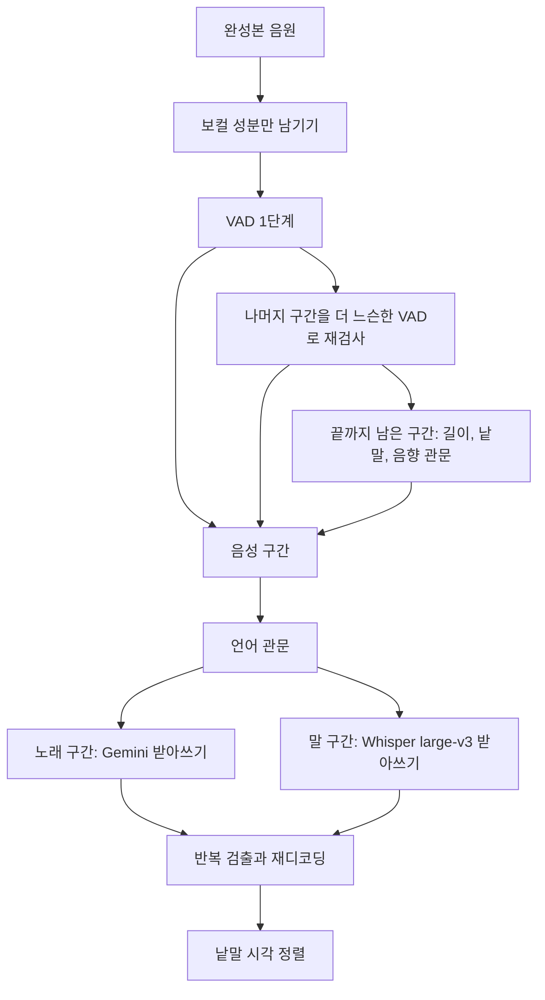
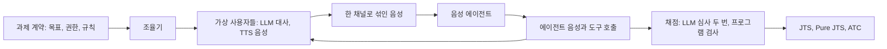
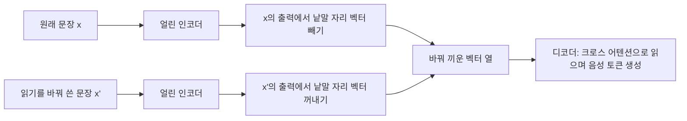
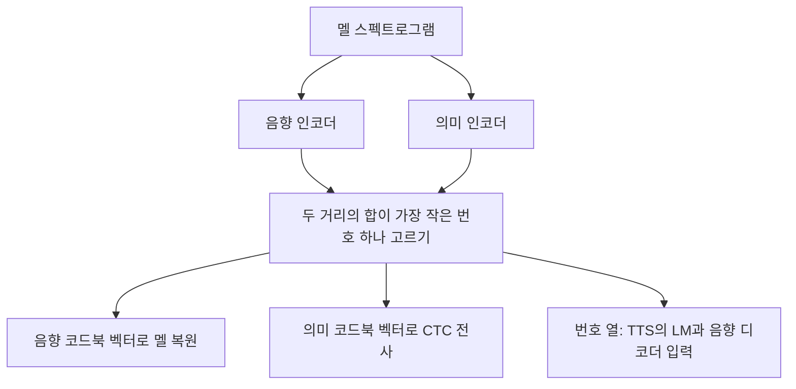
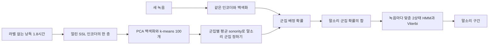

# 음성 AI 새 논문 2026-11-27 (금요일)
- **오늘의 논문**: 6편 (ASR 2편, SpeechLLM 2편, Speech Foundation Model 2편)
- **먼저 볼 것**: BiSAT: Bidirectionally Aligned Semantic-Acoustic Tokenization for Speech Language Models (복원 품질이 비슷한 토큰이라도 그 안의 내용을 얼마나 쉽게 꺼낼 수 있느냐에 따라 음성 생성의 오류율이 갈린다는 점을, CTC로 학습하는 내용 가지를 붙인 토크나이저로 보여 줘서 ASR을 아는 독자에게 가장 얻을 것이 많다고 판단했습니다.)

| 번호 | 분야 | 논문 | 한 줄 요약 |
|---|---|---|---|
| 1 | ASR, 방송 자막 인식 | [CAST: A Deployed Speech-to-Text Cascade for Closed Captioning of Entertainment Television](https://arxiv.org/abs/2611.31055) | 음악과 효과음이 깔린 TV 프로그램의 자막을 만들 때, 인식 모델은 그대로 두고 그 앞뒤에서 음성을 자르고 고치는 단계를 다시 설계해 빠지는 낱말을 줄였습니다. |
| 2 | ASR, 저자원 언어 평가 | [PazaBench: Large-Scale ASR Benchmark for Low-Resource Languages in Africa](https://arxiv.org/abs/2611.31578) | 아프리카 39개 언어의 공개 평가 데이터를 한 기준으로 묶고 공개 음성 인식 모델 52개를 같은 조건에서 돌려, 언어와 모델 구조에 따라 정확도와 속도가 어떻게 갈리는지 보였습니다. |
| 3 | SpeechLLM, 음성 에이전트 평가 | [μ-Bench: Benchmarking Multi-User Task Completion in Shared Interaction Voice Agents](https://arxiv.org/abs/2611.34920) | 여러 사람이 음성 비서 하나에게 동시에 말하며 서로 얽힌 부탁을 하는 상황을 가상 사용자로 재현해, 13개 음성 비서가 모두의 요구를 함께 풀어내는지를 쟀습니다. |
| 4 | SpeechLLM, 발음 제어 | [SpeechSplice: Pronunciation Control in Encoder-Decoder LLM-based TTS by Replacing Encoder Hidden States](https://arxiv.org/abs/2611.30927) | LLM 기반 음성 합성기가 이름이나 한자를 잘못 읽을 때, 학습 없이 그 낱말에 해당하는 내부 표현만 올바른 읽기의 것으로 바꿔 끼워 고쳤습니다. |
| 5 | Speech Foundation Model, 음성 토크나이저 | [BiSAT: Bidirectionally Aligned Semantic-Acoustic Tokenization for Speech Language Models](https://arxiv.org/abs/2611.30723) | 소리의 결을 담는 부분과 말의 내용을 담는 부분을 따로 학습하면서도 순간마다 번호 하나만 내게 해서, 음성을 만드는 언어 모델이 다루기 쉬운 토큰을 만들었습니다. |
| 6 | Speech Foundation Model, 음성 구간 검출 | [ClusterVAD: Threshold-Free Unsupervised Voice Activity Detection with Pre-Trained Neural Representations](https://arxiv.org/abs/2611.33059) | 미리 학습된 음성 모델의 내부 표현을 비슷한 것끼리 묶기만 해서, 정답 표시 없이도 사람이 말하는 구간을 찾아내는 검출기를 만들었습니다. |

## ASR

### 1. CAST: A Deployed Speech-to-Text Cascade for Closed Captioning of Entertainment Television
Aditya Mishra 외 5명(Warner Brothers Discovery), 2026-11-24 제출, 학회 채택(AAAI-27 IAAI 트랙 포스터). [논문](https://arxiv.org/abs/2611.31055)

- **분야**: ASR, 방송 자막 인식
- **한 줄 요약**: 음악과 효과음이 깔린 TV 프로그램의 자막을 만들 때, 인식 모델은 그대로 두고 그 앞뒤에서 음성을 자르고 고치는 단계를 다시 설계해 빠지는 낱말을 줄였습니다.
- **이 논문 전에는**: TV 자막은 대사 밑에 음악, 효과음, 웃음소리를 일부러 섞은 완성본 음원에서 만들어야 합니다. 널리 쓰이는 WhisperX는 VAD로 음원을 한 번 잘라 Whisper에 넣고, 강제 정렬로 낱말 시각을 붙이는 공개 파이프라인입니다. 이때 VAD를 엄격하게 잡으면 작은 목소리를 놓쳐 자막의 낱말이 빠지고, 느슨하게 잡으면 거의 무음인 구간이 들어가 Whisper가 없는 말을 지어내거나 같은 구절을 되풀이합니다. 한 번의 VAD로는 두 오류를 함께 줄일 수 없었습니다.
- **핵심 아이디어**:
  - Whisper large-v3는 미세조정 없이 그대로 두고, 그 앞뒤의 처리 단계를 다시 설계했습니다.
  - VAD를 네 단계로 겹쳐, 엄격한 설정이 음성이 아니라고 버린 구간을 점점 느슨한 설정으로 다시 검사합니다.
  - 끝까지 버려진 구간도 길이 검사, Gemini 2.5 Pro의 낱말 유무 판정, Silero VAD의 음성 길이 검사를 모두 통과하면 인식기에 넣습니다.
  - 느슨한 검출이 부르는 부작용은 뒤쪽의 언어 관문, 노래 구간 분기, 반복 출력의 재디코딩이 막습니다.
  - 모든 판단은 싼 모델이 먼저 하고, 애매한 경우에만 비싼 모델을 부릅니다.
- **어떻게 확인했나**: 대본 없는 예능 프로그램 100편(60.46시간)에서 기존에 쓰던 WhisperX 파이프라인과 비교했습니다. WER은 6.99%에서 5.36%로, 낱말 누락은 1,000낱말당 28.79개에서 19.06개로 줄었습니다. 공개 장편 데이터 세 곳에서도 누락은 줄었지만, WER 개선 폭은 0.17~0.58포인트로 작았습니다.
- **볼 만한 점**: 실제 방송 자막 서비스에 들어간 Whisper 파이프라인이 어디서 틀리고 어떻게 막았는지를 단계별 수치로 공개한 드문 사례라고 판단했습니다. "자세히"에서는 네 단계 VAD, 버린 구간을 되살리는 세 관문, 반복 출력을 고치는 절차를 설명합니다.

자세히: 네 단계 VAD, 버린 구간을 되살리는 세 관문, 언어와 노래 분기, 반복 출력 복구

- **미리 알아둘 것**:
  - 폐쇄 자막: closed captioning(CC)이라고 부르며, 시청자가 켜고 끌 수 있는 자막입니다. 대사뿐 아니라 노래 가사도 넣어야 하고, 낱말마다 화면에 뜰 시각이 필요합니다. 그래서 낱말 하나가 빠지면 자막 블록 자체가 비게 됩니다.
  - SubER: 자막 편집 거리입니다. 낱말의 삽입, 삭제, 대체에 더해 줄 바꿈과 자막 블록 경계의 오류, 낱말 묶음의 자리 이동까지 셉니다. 낱말이 맞았다고 인정하려면 시각도 겹쳐야 합니다. 그래서 글이 같아도 시각이나 줄 나눔이 다르면 점수가 나빠집니다.
  - Whisper의 30초 창: Whisper는 소리를 30초 단위로 봅니다. 긴 음원에서는 무음 확률, 평균 로그 확률, 압축률 같은 임계값으로 다음 창을 정합니다. 이 판단이 어긋나면 무음이나 음악 위에 그럴듯한 글을 지어내거나 같은 구절을 반복합니다.
  - 사용한 도구들: pyannote는 신경망 기반 화자 분할 도구이고, 이 논문은 그 VAD를 기본 검출기로 씁니다. Silero는 가벼운 신경망 VAD입니다. Demucs는 음악을 보컬, 반주 같은 성분으로 나누는 음원 분리 모델입니다. MMS-LID는 수천 개 언어를 판별하는 언어 식별 모델입니다.
- **원리**: 처리는 아래 순서로 진행합니다.
  - 1단계, 음원 분리: Demucs로 보컬 성분만 남기고 반주와 효과음 성분은 버립니다. 보컬 성분에는 대사와 노래가 모두 들어 있습니다. 분리한 소리는 인식에만 쓰고 시청자에게 내보내지 않습니다.
  - 2단계, 네 단계 VAD: 긴 음원 전체에 pyannote VAD를 돌려 음성 구간과 그 사이의 나머지 구간으로 나눕니다. 기존 방식은 나머지 구간을 버리지만, 여기서는 나머지 구간마다 더 느슨한 설정으로 다시 돌립니다. 설정은 시작 확률 임계값이 0.85에서 0.75로, 최소 음성 길이가 300ms에서 50ms로, 최소 무음 길이가 350ms에서 60ms로 단계마다 풀립니다. 다시 돌려 음성이 나온 부분은 보통의 음성 구간과 똑같이 다룹니다.
  - 3단계, 버려진 구간의 세 관문: 네 단계 모두에서 음성이 아니라고 나온 구간은 아래 관문을 차례로 통과해야 인식기에 들어갑니다.
    - 길이 관문: 300ms에서 20초 사이인 구간만 남깁니다.
    - 낱말 관문: Gemini 2.5 Pro에게 알아들을 수 있는 낱말이나 낱말 조각이 하나라도 있는지를 묻습니다. 허밍, 숨소리, 웃음, 비명, 가사 없는 음악은 아니라고 답하도록 지시합니다. 답은 정해진 JSON 꼴로만 받습니다.
    - 음향 관문: Silero VAD가 구간 안에서 합계 250ms 이상의 음성을 찾아야 합니다. 통과하면 가장 긴 음성 덩어리만 남기고, 양옆에 최대 120ms씩 여유를 붙입니다.
  - 4단계, 언어 관문: 이 시스템은 영어 자막만 만듭니다. 영어가 아닌 말이 들어가면 Whisper가 영어처럼 들리는 엉뚱한 낱말로 바꿔 대체 오류가 됩니다. 그래서 650ms보다 긴 구간마다 언어를 판별합니다.
    - Whisper-base가 영어 확률 0.8을 넘기면 바로 통과시킵니다.
    - 그렇지 않으면 MMS-LID에 묻고, 신뢰도가 0.6 이상일 때만 그 답을 받습니다.
    - 남은 구간과, 억양 있는 영어에 자주 잘못 붙는 33개 언어 표시는 Gemini가 한 번 더 판단합니다.
  - 5단계, 노래 분기: Gemini가 노래나 랩이 담긴 구간을 골라냅니다. Whisper large-v3는 노래 가사를 덜 받아쓰기 때문에, 이 구간의 받아쓰기는 Gemini가 맡습니다.
  - 6단계, 받아쓰기: 나머지 구간은 Whisper large-v3가 온도 0, 언어 영어로 받아씁니다.
    - 앞 구간과의 간격이 200ms 이하이면, 앞 구간 전사의 마지막 80낱말을 프롬프트로 줍니다.
    - 구간 맨 앞에 무음이 없으면 50ms의 무음을 덧붙입니다. 완전한 발화가 들어 있어도 Whisper가 낱말을 빼먹는 현상을 개발 중에 봤기 때문입니다.
    - 마지막 낱말이 구간 길이의 30%를 넘게 차지하면 끝이 잘린 신호로 봅니다. 이때는 뒤에 무음을 붙여 최대 두 번 다시 디코딩합니다.
  - 7단계, 반복 복구:
    - 찾기: 최대 15낱말 길이의 구절이 6번 이상 연달아 나오거나, 한 글자가 5번 이상 이어지면 후보로 봅니다. 6번이라는 기준은 "no no no"처럼 실제로 한 말이 걸리지 않을 만큼 높게 잡은 값입니다. 긴 반복은 추가 조건을 하나 더 만족해야 표시합니다.
    - 고치기: 글을 지우지 않고 소리에서 다시 디코딩합니다. 먼저 Whisper의 온도를 0.0에서 1.0까지 올려 가며 창 전체를 다시 풉니다. 그래도 반복되면 1초 간격으로 자를 지점을 찾아, 두 반쪽이 모두 깨끗해지는 첫 지점을 받아들입니다.
    - 실패 처리: 끝내 고치지 못하면 원래 전사를 그대로 둡니다. 복구가 실패해도 낱말이 지워지는 일은 없게 만든 것입니다.
  - 8단계, 정렬: 마지막에 WhisperX의 정렬기로 낱말 시각을 붙이고, 이전 시스템과 같은 출력 꼴로 내보냅니다.

- **예시로 따라가기**: 아래는 설명을 위해 만든 예이며, 논문의 실제 데이터가 아닙니다.
  - 요리 경연 프로그램의 한 장면에서, 배경 음악 위로 참가자가 작게 "it's done"이라고 중얼거립니다.
  - VAD 1단계는 이 0.8초 구간의 음성 확률이 낮아 음성이 아니라고 봅니다. 2단계에서 4단계까지도 놓쳐서, 끝까지 남은 구간이 됐다고 합시다.
  - 이 구간은 길이 관문을 통과합니다. Gemini가 "done"이라는 낱말이 들린다고 답해 낱말 관문도 통과합니다. Silero가 합계 400ms의 음성을 찾아 음향 관문도 통과하고, 가장 긴 음성 덩어리에 앞뒤 120ms를 붙인 부분만 잘라 냅니다.
  - 같은 장면 뒤쪽의 2초짜리 박수 구간은 Gemini가 낱말이 없다고 답해 버려집니다. 이런 구간이 Whisper에 들어가면 없는 글을 지어내는 원인이 됩니다.
  - 받아쓴 결과에서 같은 구절이 여섯 번 넘게 이어졌다면, 반복 복구가 그 구간을 소리에서 다시 디코딩합니다.
- **결과 더 보기**:
  - 사내 100편: SubER은 14.72%에서 11.18%로 내려갔습니다. 낱말 대체도 1,000낱말당 22.08개에서 17.20개로, 삽입도 19.07개에서 17.39개로 줄었습니다. WER은 100편 중 95편에서, SubER은 97편에서 낮아졌습니다.
  - 편집 시간: 전문 자막 작업자 15명이 어느 시스템의 결과인지 모르는 채로 35편(19.9시간)을 고쳤습니다. 프로그램 1시간당 편집 시간이 254.2분에서 221.9분으로 12.7% 줄었습니다. 35편 모두에서 CAST 쪽이 빨랐습니다.
  - 공개 데이터:
    - 사회언어학 인터뷰인 CORAAL에서 21.52%에서 21.30%로, 실적 발표 통화인 Earnings-22에서 14.04%에서 13.46%로, 팟캐스트인 Rev16에서 13.07%에서 12.90%로 WER이 내려갔습니다.
    - 누락은 1,000낱말당 11.1~11.8개 줄었지만, 삽입은 3.3~6.8개 늘었습니다. 느슨한 검출이 누락을 줄이는 대신 삽입을 늘리는 맞교환이 여기서는 드러났습니다.
    - 저자들은 자막 편집에서는 누락이 삽입보다 비싸다고 봅니다. 누락은 소리를 다시 들어야 찾을 수 있지만, 삽입은 눈으로 보고 지우면 되기 때문입니다.
  - 단계별 통계:
    - 끝까지 남은 구간 725.2분 중 길이 관문 뒤에 634.5분, 낱말 관문 뒤에 97.5분, 음향 관문 뒤에 24.8분이 남았고, 잘라 낸 뒤 6.6분이 인식기로 갔습니다.
    - 언어 판단 9,842건 중 93.5%를 Whisper-base가 바로 처리했고, 5.4%인 530건만 Gemini까지 갔습니다.
    - 반복 복구는 9,001개 구간 중 55개(0.61%)에서 작동했고, 그중 4개만 끝내 고치지 못했습니다.
  - 비용: NVIDIA L4 GPU 한 장에서 VRAM 9~12GB를 쓰고, 음원 1시간당 평균 27.4분의 계산이 든다고 적혀 있습니다.
- **한계**: Limitations 절과 배포 경험을 다룬 절에 저자가 적은 내용입니다.
  - 영어 콘텐츠만 처리합니다. 비교 대상은 이전에 쓰던 WhisperX 하나뿐이고, 상용 시스템과는 비교하지 않았습니다.
  - 버린 구간을 되살리는 경로와 반복 복구 단계를 켜고 끈 비교 실험이 없습니다. 그래서 전체 오류 감소를 어느 단계의 몫으로 돌릴 수 없습니다.
  - 기준 자막은 제작 과정에서 편집된 자막이라, 만들어진 경위가 독립적으로 확인되지 않았습니다.
  - 겹쳐 말하는 화자의 받아쓰기는 범위 밖입니다. 서비스 전환이 최근이라 운영 효과도 아직 충분히 재지 못했습니다.
  - 같은 음원을 다섯 번 다시 돌렸을 때 Gemini가 버려진 구간의 1.6~2.6%에서 판단을 바꿨습니다. 저자들은 프롬프트를 조이고 Silero 검사와 자르기를 더해 결과가 같아지게 만들었습니다.

### 2. PazaBench: Large-Scale ASR Benchmark for Low-Resource Languages in Africa
Mercy Muchai 외 3명(Microsoft Research Africa), 2026-11-24 제출, 학회 채택(Deep Learning Indaba 2026). [논문](https://arxiv.org/abs/2611.31578), [리더보드](https://huggingface.co/spaces/microsoft/paza-bench)

- **분야**: ASR, 저자원 언어 평가
- **한 줄 요약**: 아프리카 39개 언어의 공개 평가 데이터를 한 기준으로 묶고 공개 음성 인식 모델 52개를 같은 조건에서 돌려, 언어와 모델 구조에 따라 정확도와 속도가 어떻게 갈리는지 보였습니다.
- **이 논문 전에는**: 아프리카 언어는 다국어 ASR 벤치마크에 적게 들어가고, 들어가더라도 여러 언어의 평균 하나로 요약되곤 했습니다. 평균은 언어마다 다른 실패를 가립니다. 아프리카 언어 전용 벤치마크도 있었지만, CTC 계열, Whisper 계열, LLM 기반처럼 구조가 다른 모델을 추론 속도와 함께 비교하지는 않았습니다. 그래서 실제로 배포할 모델을 고를 근거가 부족했습니다.
- **핵심 아이디어**:
  - 공개 말뭉치 6개를 같은 전처리와 텍스트 정규화로 묶어, 39개 언어 199,438개 발화의 평가 세트를 만들었습니다.
  - Hugging Face에서 받을 수 있는 공개 모델 52개를, 같은 GPU와 같은 배치 크기에서 모델 카드의 기본 설정으로 돌렸습니다.
  - 모델을 인코더 전용, 인코더-디코더, LLM 기반의 세 구조로 나누고, WER, CER, 처리 속도를 함께 쟀습니다.
  - 차이가 우연인지를 비모수 통계 검정으로 확인했습니다.
- **어떻게 확인했나**: 결과를 언어별, 언어 계통별, 구조별로 나눠 비교했습니다. 모든 언어에 걸친 중앙값 CER이 가장 낮은 모델은 omniASR-LLM-7B로 0.09였지만, 처리 속도는 실시간의 7.5배에 그쳤습니다. 같은 계열의 CTC 모델인 omniASR-CTC-300M은 CER 0.16에 실시간의 639.3배 속도였습니다.
- **볼 만한 점**: 저자원 언어에서는 학습 데이터의 양보다 문자 체계가 오류율을 더 크게 좌우할 수 있다는 결과와, 정확도와 속도의 맞교환을 한 표에서 볼 수 있다는 점에서 골랐습니다. "자세히"에서는 평가 세트의 구성, 통계 검정의 방식, 영어 전용 모델을 뺐을 때 결론이 어떻게 바뀌는지를 설명합니다.

자세히: 평가 세트 구성, 구조별 비교와 통계 검정, 언어와 문자 체계에 따른 차이

- **미리 알아둘 것**:
  - RTFx: 처리 속도를 실시간의 몇 배인지로 나타낸 값입니다. 1시간 음성을 1분에 처리하면 60입니다. 클수록 빠릅니다.
  - 중앙값과 순위 기반 검정: 논문은 모델과 언어를 오류율의 중앙값으로 비교합니다. 정규성 검정에서 모든 묶음의 분포가 정규분포가 아니고 분산도 다르다고 나왔기 때문에, 통계 검정도 값의 순위만 쓰는 방법을 골랐습니다. 표의 오류율은 비율이라 0.34는 34%를 뜻합니다.
  - Kruskal-Wallis 검정과 Cliff's delta: Kruskal-Wallis 검정은 세 묶음 이상의 분포가 같은지를 순위로 검정합니다. Cliff's delta는 두 묶음에서 하나씩 뽑았을 때 한쪽이 더 클 확률에서 반대쪽이 더 클 확률을 뺀 값입니다. -1에서 1 사이이고, 0이면 차이가 없다는 뜻입니다.
  - 언어 계통: 언어를 공통 조상으로 묶은 갈래입니다. 이 벤치마크에는 니제르콩고 26개, 아프리카아시아 9개, 나일사하라 3개, 인도유럽 1개가 들어 있습니다. 니제르콩고에는 스와힐리어, 요루바어, 줄루어 등이, 아프리카아시아에는 아랍어, 암하라어, 하우사어 등이 속합니다. 인도유럽 계통은 아프리칸스어 하나입니다.
- **원리**: 벤치마크 논문이라 무엇을 어떤 조건에서 쟀는지를 순서대로 적습니다.
  - 데이터 묶기: 아래 여섯 말뭉치를 썼습니다. 고른 기준은 대표성이 낮은 아프리카 언어를 담았는지, 검증된 전사가 있는지, 라이선스가 맞는지, 메타데이터가 표준화돼 있는지, 따로 떼어 둔 평가 분할이 있는지의 다섯 가지입니다.
    - Common Voice 23.0: 크라우드소싱 음성이고, 23개 언어 78,546개 발화입니다.
    - Naija Voices: 대화 음성이고, 3개 언어 57,529개 발화입니다.
    - African Next Voices 케냐분: 대화 음성이고, 5개 언어 24,508개 발화입니다.
    - African Next Voices 남아공분: 대화 음성이고, 6개 언어 21,692개 발화입니다.
    - FLEURS: 낭독 음성이고, 20개 언어 12,813개 발화입니다.
    - ALFFA: 방송과 낭독 음성이고, 3개 언어 4,350개 발화입니다.
  - 전처리:
    - 모든 음성을 16kHz 모노로 바꿨습니다.
    - 채점 전에 문장부호를 지우고, 대소문자를 하나로 맞추고, 공백을 정리했습니다.
    - 평가 분할이 없는 Naija Voices는 섞은 뒤 3%를 뽑아 평가에 썼습니다.
    - 언어 코드를 받아야 하는 모델에는 그 모델이 쓰는 코드 체계로 바꿔 넣었습니다.
  - 모델과 구조 분류:
    - 15개 계열 52개 모델이고, 그중 19개는 영어만 학습한 모델입니다. 아프리카 언어를 학습하지 않은 모델도 같은 조건으로 돌렸습니다.
    - 인코더 전용은 wav2vec 2.0, HuBERT, data2vec, MMS, omniASR-CTC입니다.
    - 인코더-디코더는 Whisper 계열, Moonshine, Parakeet-TDT, SeamlessM4T입니다.
    - LLM 기반은 Phi-4-MM, Qwen2-Audio, omniASR-LLM, Canary-Qwen, Granite Speech, Kyutai STT입니다.
  - 실행 조건: A100 80GB GPU 한 장에서 발화를 하나씩 처리했습니다. Open ASR Leaderboard의 평가 틀을 따랐습니다.
  - 검정: 세 구조의 차이는 Kruskal-Wallis 검정으로 보고, 어느 쌍이 다른지는 Dunn 사후 검정으로 봤습니다. 여러 쌍을 비교할 때는 Holm-Bonferroni 보정을 했습니다. 효과 크기는 Cliff's delta로, 상관은 Spearman 상관과 부트스트랩 신뢰 구간으로 보고했습니다.
  - 확인 단계: 영어 전용 모델 19개를 뺀 뒤 모든 검정을 다시 했습니다. 이 모델들이 결론을 왜곡하는지 보기 위해서입니다.
- **예시로 따라가기**: 논문 표 2의 수치로 모델 하나를 고르는 과정을 따라가 봅니다. 고르는 상황은 설명을 위해 정한 것이고, 시간 계산은 리포트가 한 것입니다.
  - 39개 언어에 두루 쓸 모델로, GPU 한 장에서 많은 음성을 처리해야 한다고 합시다.
  - 정확도만 보면 omniASR-LLM-7B가 중앙값 CER 0.09, WER 0.34로 가장 좋습니다. 그런데 RTFx가 7.5라서 1시간 음성에 약 8분이 걸립니다.
  - omniASR-CTC-7B는 CER 0.11에 RTFx 128.0입니다. 정확도를 조금 내주고 약 17배 빨라집니다.
  - omniASR-CTC-300M은 CER 0.16에 RTFx 639.3입니다. 파라미터가 3억 2,500만 개라 작은 장비에도 올리기 쉽습니다.
  - parakeet-tdt-0.6b-v3는 RTFx 2181.6으로 가장 빠르지만 CER이 0.48입니다. 이 언어들에서는 속도만 보고 고를 수 없다는 뜻입니다.
- **결과 더 보기**:
  - 언어별: 아랍어는 중간 정도의 자원을 가진 언어인데도 CER이 0.90을 넘어 가장 높았습니다. 암하라어와 타마지트어도 CER이 높고 모델마다 차이가 컸습니다. 링갈라어, 루간다어, 니웅웨어는 중앙값 CER이 0.35 아래로 가장 낮았습니다. 논문은 라틴 문자 위주로 학습한 모델에서는 문자 체계의 복잡도가 데이터 양보다 성능을 더 크게 좌우할 수 있다고 해석합니다.
  - 계통별: 52개 모델을 모두 합친 중앙값 CER은 인도유럽 0.561, 니제르콩고 0.665, 나일사하라 0.790, 아프리카아시아 0.964였습니다. 지원하지 않는 언어에서 실패한 모델까지 섞인 값이라 절대 수준이 높게 나온 것으로 보입니다. 이 해석은 리포트의 판단입니다.
  - 구조별:
    - CER 분포는 세 구조 사이에 유의한 차이가 있었습니다. 검정 통계량 H는 924.8이었습니다.
    - 인코더-디코더와 인코더 전용의 차이가 가장 컸고, Cliff's delta는 0.71이었습니다.
    - 인코더 전용과 LLM 기반의 차이는 -0.09로 거의 없었습니다.
    - 속도 차이는 더 뚜렷해서, 모든 쌍의 Cliff's delta가 0.75를 넘었습니다.
  - 영어 전용 모델을 뺐을 때: 인코더 전용과 LLM 기반의 Cliff's delta가 -0.09에서 -0.40으로 커졌습니다. 논문은 앞서 보인 비슷함의 일부가, 영어 전용 모델이 영어 낱말이 겹치는 덕에 적당한 CER을 낸 데서 왔다고 해석합니다. WER과 CER의 Spearman 상관도 0.64에서 0.81로 올랐습니다.
  - WER과 CER의 관계: 둘의 상관은 0.64였습니다. 아프리카아시아 계통은 WER로 예상되는 것보다 CER이 체계적으로 높았습니다. 논문은 형태가 복잡하거나 라틴 문자가 아닌 언어에서는 CER을 함께 보고해야 한다고 결론 내립니다.
  - 분류에 대한 참고: 본문은 TDT를 인코더 전용 쪽의 디코딩 방식으로 설명하지만, 표에서는 Parakeet-TDT를 인코더-디코더로 분류했습니다. 구조별 비교를 읽을 때 이 점을 감안하는 편이 좋다고 판단했습니다.
- **한계**: 6절 Limitations에 저자가 적은 내용입니다.
  - 공개 평가 데이터가 대형 모델의 사전학습 데이터에 섞였을 수 있습니다. 그래서 결과는 절대 성능이 아니라 같은 조건에서의 상대 비교로 읽어야 합니다.
  - 아프리카 언어의 다양성을 다 담지 못했고, 공개 데이터가 아주 적은 언어는 빠졌습니다.
  - LLM 기반 모델이 정확한 이유의 일부는 글 사전학습에서 겹친 내용 덕일 수 있습니다.
  - 도메인 변화, 잡음, 화자 집단에 따른 강건성은 평가하지 않았습니다.

## SpeechLLM

### 3. μ-Bench: Benchmarking Multi-User Task Completion in Shared Interaction Voice Agents
Qihao Lin 외 9명(상하이교통대, 상하이 AI 연구소, 중국과학원대, 푸단대, 칭화대), 2026-11-26 제출, 프리프린트. [논문](https://arxiv.org/abs/2611.34920), [코드](https://github.com/lqh1106/mu-bench), [데이터](https://huggingface.co/datasets/linqihao/mu-bench)

- **분야**: SpeechLLM, 음성 에이전트 평가
- **한 줄 요약**: 여러 사람이 음성 비서 하나에게 동시에 말하며 서로 얽힌 부탁을 하는 상황을 가상 사용자로 재현해, 13개 음성 비서가 모두의 요구를 함께 풀어내는지를 쟀습니다.
- **이 논문 전에는**: 음성 에이전트의 과제 수행 평가는 대개 사용자 한 명을 가정합니다. 여러 화자를 다루는 벤치마크도 있었지만, 주로 차례 주고받기를 재거나 녹음된 장면을 보고 답하게 하는 방식이었습니다. 실제로는 가족이 탄 차 안처럼 여러 사람이 마이크 하나에 동시에 말하고, 각자의 목표와 권한이 서로 얽힙니다. 에이전트의 질문이나 거절에 따라 사람들의 다음 말이 바뀌는 상황을 평가할 방법이 없었습니다.
- **핵심 아이디어**:
  - 가상 사용자 여럿이 실시간으로 반응하는 닫힌 고리 시뮬레이터를 만들었습니다. 사용자마다 자기 목표, 아는 정보, 권한만 가진 채, 자기가 들은 말과 에이전트의 행동에 따라 LLM으로 다음 대사를 쓰고 TTS로 말합니다.
  - 20개 분야 100개 장면을 사람 수, 음향 조건, 확인 요구의 세 조건으로 곱해 800개 평가 사례를 만들었습니다.
  - 주 지표인 JTS(Joint Task Success)는 모든 사용자의 목표, 개인정보 경계, 최종 상태가 한 대화 안에서 동시에 지켜질 때만 성공으로 칩니다. 한 사람의 부탁을 들어줘도 다른 사람의 개인정보를 흘리면 실패입니다.
- **어떻게 확인했나**: GPT-Realtime-2, Gemini 3.8 Live 같은 상용 시스템 5개와 MiniCPM-o 4.5, Moshi 같은 공개 모델 8개를 평가했습니다. 도구를 쓰지 않는 과제에서 상용 시스템의 JTS는 37.50~62.24%였습니다. 공개 모델은 모두 20% 아래였고, 가장 좋은 MiniCPM-o 4.5가 19.39%였습니다.
- **볼 만한 점**: 듣는 동시에 말하는 전이중 모델이 차례 주고받기를 잘해도, 여러 사람의 과제를 함께 푸는 능력으로는 이어지지 않는다는 점을 수치로 보여 줘서 골랐습니다. "자세히"에서는 시뮬레이터의 동작, 채점 규칙, 겹친 말을 차례대로 펴 주었을 때의 변화를 설명합니다.

자세히: 닫힌 고리 시뮬레이터, JTS와 세 진단 지표, 도움을 하나씩 더한 실험, 권한 없는 도구 호출

- **미리 알아둘 것**:
  - 전이중 음성 에이전트: full-duplex 에이전트라고도 부르며, 말하는 동안에도 계속 듣습니다. 사용자가 끼어들면 말을 멈추거나 맞장구에 반응할 수 있습니다.
  - 닫힌 고리 평가: 미리 녹음한 대화를 틀어 주고 답을 채점하는 대신, 에이전트의 응답에 따라 가상 사용자의 다음 말이 정해지게 하는 평가입니다. 에이전트가 되묻거나 거절하면 대화의 흐름이 바뀝니다.
  - 도구 호출: 에이전트가 예약 변경이나 계산서 나누기 같은 백엔드 기능을 부르는 것입니다. 이 벤치마크에서는 호출마다 누가 요청했는지를 함께 적어야 하고, 그 사람의 권한으로 허용된 호출인지 검사합니다.
  - ATC 진단: Attribution, Threading, Coordination의 머리글자입니다. Attribution은 어떤 말이 누구의 요청이고 누구에게 하는 말인지를 맞게 가렸는지 봅니다. Threading은 사람마다 진행 중인 과제를 기억하고 이어 가는지 봅니다. Coordination은 권한과 개인정보 규칙을 지키고 사람들을 고르게 대했는지 봅니다.
- **원리**:
  - 과제 계약: 사례마다 참가자, 초기 상태, 쓸 수 있는 도구, 사람별 목표, 권한과 개인정보 규칙을 적은 계약이 있습니다. 사람별 목표에는 들어주기뿐 아니라 되묻기, 거절하기, 옆 사람끼리의 잡담 무시하기도 들어갑니다. 이 계약은 에이전트에게 보이지 않습니다.
  - 시뮬레이터:
    - 조율기가 장면의 각본에 따라 사건을 일으킵니다. 요청이 풀리지 않은 채 대화가 끝나 가면 최대 두 번까지 후속 질문을 보냅니다.
    - 가상 사용자는 자기 인물 정보, 조율기가 보낸 사건, 자기가 들은 말의 기록만 보고 다음 대사를 씁니다. 사용자가 끼어들어 에이전트의 말이 도중에 끊기면, 실제로 재생된 부분만 기록에 남습니다.
    - 대사는 gpt-6-luna가 쓰고, Fun-CosyVoice3-0.5B가 16kHz 음성으로 읽습니다. 에이전트가 낸 음성은 Whisper large-v3로 받아써서 가상 사용자에게 전달합니다.
  - 시간 맞추기: 시뮬레이터가 대사를 쓰고 합성하는 동안에는 논리 시간을 멈춥니다. 그래서 가상 사용자의 생각 시간이 에이전트에게 침묵으로 들리지 않습니다. 시계는 200ms 단위로 가고, 한 사례의 상한은 논리 시간 1,800초입니다.
  - 조건 바꾸기: 사람 수는 2~3명과 4~7명, 음향은 깨끗한 말과 말더듬이 섞인 자연스러운 말, 후속 요구는 바로 이해와 반복된 확인 요청 중에서 고릅니다. 같은 장면의 여덟 가지 변형을 비교할 수 있어서, 조건 하나의 효과만 떼어 볼 수 있습니다.
  - 채점:
    - LLM 심사관이 목표 처리, 개인정보 규칙, 능력 주장을 항목별로 판정합니다. 새 문맥에서 독립적으로 한 번 더 판정하고, 둘이 다르면 익명 중재로 정합니다.
    - 도구 호출은 프로그램이 직접 검사합니다. 선언한 요청자의 권한, 매개변수, 분야 규칙을 확인하고, 나중의 발화로 앞선 행동을 정당화할 수 없도록 시간 순서도 봅니다.
    - JTS는 도구 실행과 최종 상태, 모든 사람의 목표 처리, 개인정보 보존이 모두 참일 때만 1입니다.
    - Pure JTS는 여기에 권한 없는 도구 호출이 하나도 없어야 한다는 조건을 더합니다. 도구 쪽은 에이전트가 적은 요청자를 그대로 믿기 때문에, 남의 이름으로 호출해 최종 상태만 맞출 수 있어서 둔 지표입니다.

- **예시로 따라가기**: 논문 1절과 5.4절의 사례를 따라갑니다.
  - 공항으로 가는 가족의 차 안입니다. 부모는 10시 전에 도착해야 하고, 아이가 끼어들어 공원에 들르자고 합니다. 에이전트는 공원에 들러도 10시 전에 닿는지 경로를 확인하고, 결정 권한이 있는 부모의 승인을 받아야 합니다.
  - 5.4절의 식당 장면에는 다섯 사람이 나옵니다. Avery는 계산서를 똑같이 나누자고 하고, Blake는 자기 음식만 따로 계산하자고 합니다. 등록 정보에서 Avery에게는 예약 조회 권한이, Blake에게는 개별 계산 권한이 있습니다.
  - Gemini 3.8 Live는 먼저 Blake의 이름으로 예약을 조회하려다 거부당합니다. 그러고는 이 거부를 넓게 해석해, Blake에게 허용된 개별 계산 요청까지 거절합니다.
  - 권한이 없는 Cameron이 인원 확인을 부탁하자, 에이전트는 Cameron을 Avery로 착각해 Avery의 이름으로 예약을 두 번 조회합니다.
  - Cameron의 요청은 처리됐지만 Blake의 요청은 남았기 때문에, 이 사례는 JTS에서 실패입니다.
- **결과 더 보기**:
  - 도구를 쓰는 과제: GPT-Realtime-2가 65.44%, Gemini 3.8 Live가 64.95%, Grok Voice 3.0이 57.60%, Seeduplex 3.0이 50.00%였습니다. 도구 없는 과제의 1위인 Grok Voice 3.0이 여기서는 3위로, 두 과제의 순위가 달랐습니다.
  - 진단 지표의 함정: 공개 모델 8개는 JTS와 Threading이 거의 0인데도 Coordination이 76.43~87.17%로 높았습니다. 앞의 대화를 잊고 마지막 말에만 반응하니, 남의 정보를 흘리거나 권한 없는 행동을 할 일도 없었던 것입니다. Coordination만 보면 능력을 과대평가하게 된다고 논문은 지적합니다.
  - 사람 수: 2~3명에서 4~7명으로 늘리면, 도구를 쓰는 상용 시스템의 JTS가 상대적으로 19.64~29.48% 떨어졌습니다. 말더듬이 섞인 음향 조건의 영향은 Seeduplex 3.0을 빼면 8.8% 이내로 작았습니다.
  - 도움을 하나씩 더한 실험:
    - MiniCPM-o 4.5에 겹친 말과 끼어들기를 차례대로 펴서 주자, JTS가 19.39%에서 26.79%로 7.40포인트 올랐습니다.
    - 말한 사람과 들을 사람의 정답 정보를 더하면 2.81포인트, 요청 내용을 구조화해 주면 1.79포인트가 더 올라 31.38%가 됐습니다.
    - 그래도 68.62%의 사례는 풀리지 않았습니다. 논문은 겹친 소리를 듣는 문제를 넘어, 여러 사람의 계획을 조율하는 일 자체가 어렵다는 뜻으로 해석합니다.
  - 권한 없는 도구 호출: 도구 과제의 21.81~71.81% 사례에서 권한 없는 호출이 한 번 이상 나왔습니다. Pure JTS로 바꾸면 점수가 11.0~24.0포인트 내려갑니다. GPT-Realtime-2는 52.5%, Gemini 3.8 Live는 46.8%가 됐고, Seeduplex 3.0은 50.0%에서 26.0%로 떨어졌습니다.
- **한계**: 한계를 다룬 절은 따로 없습니다. 아래는 리포트가 실험 설정에서 읽은 범위입니다.
  - 사용자의 말은 LLM이 쓰고 TTS가 읽은 합성 음성입니다. 실제 사람들의 겹친 대화와는 다를 수 있습니다.
  - 채점의 상당 부분을 LLM 심사관이 맡습니다. 두 번 독립 판정하고 중재하는 장치는 있지만, 심사관 자체의 오류율은 보고되지 않았습니다.
  - 에이전트 음성의 받아쓰기는 영어로 고정돼 있어, 평가가 영어 대화에 한정됩니다.
  - 사례마다 한 번 실행한 결과를 보고합니다. MOSS-Live의 도구 과제 결과는 평가 시점 이후에 기능이 나와 빠졌다고 적혀 있습니다.

### 4. SpeechSplice: Pronunciation Control in Encoder-Decoder LLM-based TTS by Replacing Encoder Hidden States
Kiyoshi Kurihara 외 3명(Matsuo Institute, 도쿄대), 2026-11-24 제출, 학회 채택(Findings of EACL 2027). [논문](https://arxiv.org/abs/2611.30927), [코드](https://github.com/Kuri-san-jp/speechsplice)

- **분야**: SpeechLLM, 발음 제어
- **한 줄 요약**: LLM 기반 음성 합성기가 이름이나 한자를 잘못 읽을 때, 학습 없이 그 낱말에 해당하는 내부 표현만 올바른 읽기의 것으로 바꿔 끼워 고쳤습니다.
- **이 논문 전에는**: 예전 TTS는 글자를 발음 기호로 바꾸는 G2P(grapheme-to-phoneme) 모듈을 맨 앞에 두었습니다. 발음이 틀리면 G2P 사전의 항목 하나만 고치면 됐습니다. LLM 기반 TTS는 글에서 음성 토큰까지 한 모델로 바로 가기 때문에, 이렇게 고칠 손잡이가 사라졌습니다. 미세조정으로 고칠 수는 있지만, 품질이 떨어지거나 말소리가 무너지는 문제가 보고돼 있습니다.
- **핵심 아이디어**:
  - 인코더와 디코더가 나뉜 TTS에서는 디코더가 크로스 어텐션으로 인코더의 마지막 출력만 읽는다는 점에 착안했습니다.
  - 원래 문장과, 문제 낱말만 원하는 읽기로 바꿔 쓴 문장을 같은 인코더에 각각 넣습니다. 일본어라면 한자 낱말을 의도한 읽기의 가타카나로 바꿔 쓰는 식입니다.
  - 원래 문장의 인코더 출력에서 그 낱말 자리의 벡터만 바꿔 쓴 문장의 해당 벡터로 갈아 끼우고, 나머지 자리는 그대로 둡니다.
  - 가중치는 하나도 건드리지 않으므로 학습이 필요 없습니다.
- **어떻게 확인했나**: T5Gemma-TTS로 영어, 일본어, 중국어 원어민 청취 평가를 했습니다. 두 소리 중 목표 읽기를 낸 쪽을 고르게 했더니 SpeechSplice 쪽을 고른 비율이 98.6~100.0%였고, 자연스러움 점수는 바꾸기 전과 유의한 차이가 없었습니다. 공개 TTS 10개로 넓혀 보니, 인코더-디코더 구조에서는 잘 들었고 디코더만 있는 구조에서는 잘 듣지 않았습니다.
- **볼 만한 점**: 학습 없이 바로 쓸 수 있는 방법이고, 어떤 구조에서 왜 통하는지를 10개 시스템으로 갈라 보여 줘서 LLM 기반 음성 생성 모델의 내부 통로를 이해하는 데 도움이 된다고 판단했습니다. "자세히"에서는 벡터를 끼워 넣는 계산, 구조에 따라 결과가 갈리는 이유, 끼워 넣는 깊이를 바꾼 실험을 설명합니다.

자세히: 인코더 출력 끼워 넣기의 계산, 인코더-디코더와 디코더 전용 구조의 차이, 깊이 실험

- **미리 알아둘 것**:
  - 인코더-디코더 TTS: 인코더가 글을 먼저 읽어 벡터 열로 만들고, 디코더가 음성 토큰을 만들면서 크로스 어텐션으로 그 벡터 열을 참조합니다. 어텐션 기반 인코더-디코더 ASR의 방향을 뒤집은 구조라고 보면 됩니다. 이 비유는 설명을 위한 것입니다. 이 논문의 주 실험 모델인 T5Gemma-TTS가 이쪽입니다.
  - 디코더 전용 TTS: 글 토큰과 음성 토큰을 한 줄로 이어 붙여 셀프 어텐션 스택 하나에서 처리합니다. Qwen3-TTS, Llasa, XTTS-v2가 이쪽입니다. 음성 토큰은 모든 층에서 글 토큰을 다시 읽습니다.
  - 동형이음어와 오쿠리가나: 동형이음어(heteronym)는 철자가 같고 읽기가 다른 낱말입니다. 영어 "read"의 현재형과 과거형이 예입니다. 오쿠리가나는 일본어에서 한자 뒤에 붙어 읽기를 정하는 가나입니다. 일본어 한자는 문맥에 따라 읽기가 달라서 TTS가 자주 틀립니다.
  - PIB(Phoneme Injection-Better): 300쌍 중, 끼워 넣은 뒤 그 낱말의 음소 오류율이 목표 읽기 기준으로 내려간 쌍의 비율입니다. 음소 인식기로 잽니다.
  - Whisper-INJ와 MCD: Whisper-INJ는 끼워 넣어 만든 음성을 ASR로 받아썼을 때 목표 읽기가 전사에 들어 있는 비율입니다. MCD는 멜 켑스트럼 왜곡으로, 두 음성의 스펙트럼 차이를 dB로 잰 값입니다. 여기서는 끼우기 전과 후의 음성이 얼마나 달라졌는지를 봅니다.
- **원리**:
  - 1단계, 두 문장 만들기: 원래 문장 x에 문제 낱말 e가 있습니다. e만 원하는 읽기가 드러나게 바꿔 쓴 문장 x'를 만듭니다. 원하는 읽기는 사용자가 추론 때 직접 줍니다.
  - 2단계, 낱말 자리 찾기: 문장 전체를 토큰화하면서 각 토큰의 글자 위치를 함께 기록합니다. e의 글자 범위와 겹치는 토큰을 x에서 m개, x'에서 n개 찾습니다.
  - 3단계, 인코딩: x와 x'를 같은 얼린 인코더에 넣어 마지막 층의 출력 H와 H'를 얻습니다.
  - 4단계, 끼워 넣기: H에서 e의 벡터 m개를 빼고, 그 자리에 H'의 벡터 n개를 넣습니다. 길이가 m에서 n으로 바뀌므로 어텐션 마스크와 위치 번호를 새 길이에 맞게 다시 만듭니다. 길이를 유지해야 할 때는 n개 벡터를 가중 평균해 m개 자리에 씁니다.
  - 5단계, 생성: 디코더는 바뀐 벡터 열을 크로스 어텐션으로 읽으며 음성 토큰을 만듭니다. 시드와 디코딩 설정은 원래 문장을 합성할 때와 같게 둡니다.
  - 통하는 조건: 디코더가 글을 읽는 통로가 끼워 넣은 바로 그 텐서여야 합니다. 인코더-디코더 구조는 이 조건을 만족합니다. 디코더 전용 구조에서는 음성 토큰이 모든 층에서 글 토큰의 키와 값을 읽습니다. 그래서 마지막 층 근처에서만 바꾸면, 그 아래 층들은 여전히 원래 낱말을 읽습니다.
  - 또 하나의 전제: 토크나이저가 원래 낱말과 바꿔 쓴 낱말에 서로 다른 토큰을 줘야 합니다. 영어 전용 토크나이저를 쓰는 SpeechT5는 일본어와 중국어에서 두 낱말에 같은 토큰을 줘서, 바꿔 끼워도 출력이 같았습니다. 그래서 그 두 조건은 실험에서 뺐습니다.

- **예시로 따라가기**: 아래는 논문의 방법을 영어 동형이음어에 적용해 리포트가 만든 예이며, 논문의 실제 문항이 아닙니다.
  - x는 "We read the report yesterday."입니다. 합성기가 "read"를 현재형처럼 [리드]로 읽는다고 합시다.
  - x'는 "We red the report yesterday."입니다. 철자로는 틀렸지만, 원하는 소리인 [레드]를 드러내는 표기입니다.
  - 두 문장을 같은 인코더에 넣고, x에서 "read"에 해당하는 토큰 자리를, x'에서 "red"에 해당하는 토큰 자리를 찾습니다.
  - x의 출력에서 "read" 자리 벡터를 빼고 x'의 "red" 자리 벡터를 끼웁니다. "We"와 "the report yesterday" 자리의 벡터는 x의 것이 그대로 남습니다.
  - 디코더는 바뀐 벡터 열을 읽어 그 낱말을 [레드]로 냅니다. 이 방법은 원래 합성과 같은 발화 길이를 쓰도록 설계됐고, 실험에서도 화자 유사도와 음높이의 변화가 작았습니다.
- **결과 더 보기**:
  - 다른 방법과의 비교: 영어에서 목표 읽기가 전사에 나온 비율이 SpeechSplice 96.33%, VoiceCraft 90.00%, EdiTTS 86.00%였습니다. VoiceCraft는 바꿔 쓴 문장 전체를 새로 합성하는 방식이고, EdiTTS는 확산 모델로 해당 부분만 고치는 방식입니다. 발화 길이의 변화는 SpeechSplice가 0.00초로, 0.20초와 0.13초인 두 방법보다 작았습니다.
  - 구조별 PIB: 인코더-디코더 5개 시스템은 41.67~65.33%였고, 디코더 전용 5개는 2.67~27.00%였습니다. 두 묶음의 범위가 겹치지 않았습니다. 디코더 전용에서도 MCD가 0보다 커서 소리는 바뀌었지만, 목표 읽기 쪽으로 바뀌는 경우는 적었습니다.
  - 깊이 실험:
    - 인코더-디코더에서는 어느 층에서 바꿔도 PIB가 비슷했습니다. 앞 층에서 바꾼 것이 남은 층을 거쳐 마지막 출력까지 전달되기 때문입니다.
    - 디코더 전용에서는 첫 층에서 바꾸면 논문의 기본 교체 지점보다 PIB가 크게 올랐습니다. 깊이를 바꿔 가며 얻은 최고값은 XTTS-v2가 54.67%, Llasa-3B 영어가 51.33%였습니다.
    - Qwen3-TTS만은 어느 깊이에서도 15.00% 이하에 머물렀습니다.
  - 두 낱말 동시 교정: 인코더-디코더 조건에서는 한 문장의 두 낱말을 함께 바꿔도 정확도가 떨어지지 않았습니다. 디코더 전용 조건에서는 기본 교체 지점에서 바꾼 낱말이 한 번도 의도대로 읽히지 않았습니다.
  - 크로스 어텐션 차단: 낱말 자리로 가는 크로스 어텐션을 막으면, 끼워 넣기 전과 후의 음성이 거의 같아졌습니다. 바꾼 정보가 이 통로로 전달된다는 증거입니다.
  - 일본어 읽기 벤치마크: 부록 C의 160문항에서, 바꾸기 전 모델이 확실히 잘못 읽은 45개를 모두 고쳤습니다.
- **한계**: Limitations 절에 저자가 적은 내용입니다.
  - 비교한 10개 시스템은 구조, 학습 데이터, 언어, 토크나이저, 크기가 함께 다릅니다. 그래서 어떤 단일 요인이 성패를 가르는지는 확정할 수 없습니다.
  - 어느 깊이에서 바꿀지는 실험으로만 정했고, 미리 고르는 기준이 없습니다.
  - 원하는 읽기를 추론 때 정확히 지정해 줘야 합니다.
  - 자연스러움 평가는 언어마다 목소리 하나로만 했습니다. 청취 평가 밖의 발음 판정은 ASR과 음소 인식기로 했고, 높낮이 악센트는 평가하지 않았습니다.
  - 긴 글, 다양한 화자, 저자원 언어, 서로 가까이 붙은 낱말, 한 문장에 세 낱말 이상을 고치는 경우는 시험하지 않았습니다.

## Speech Foundation Model

### 5. BiSAT: Bidirectionally Aligned Semantic-Acoustic Tokenization for Speech Language Models
Yixian Lu, Lijun Wang, Shogo Okada(일본 첨단과학기술대학원대학), 2026-11-23 제출, 프리프린트. [논문](https://arxiv.org/abs/2611.30723)

- **분야**: Speech Foundation Model, 음성 토크나이저
- **한 줄 요약**: 소리의 결을 담는 부분과 말의 내용을 담는 부분을 따로 학습하면서도 순간마다 번호 하나만 내게 해서, 음성을 만드는 언어 모델이 다루기 쉬운 토큰을 만들었습니다.
- **이 논문 전에는**: 음성 LM에 쓰는 토크나이저는 세 갈래였습니다. ASR 같은 이해 모델 안에 양자화를 넣는 쪽(CosyVoice 계열)은 내용은 잘 담지만 목소리의 결을 많이 잃습니다. 복원만으로 학습하는 코덱은 음향을 잘 담지만, 음색과 녹음 조건의 변화까지 담아서 LM이 낱말을 빼먹거나 반복하게 만듭니다. 둘을 섞는 통합형(SpeechTokenizer, X-Codec2 등)은 한 특징 공간에 두 정보를 함께 넣어 서로 간섭하고, 얼린 교사 모델이 주는 고정된 목표에 맞춥니다.
- **핵심 아이디어**:
  - 음향 가지와 의미 가지를 따로 두고, 가지마다 인코더, 코드북, 디코더를 둡니다. 음향 가지는 적대적 학습 없이 멜 스펙트로그램을 복원하고, 의미 가지는 CTC로 전사를 맞힙니다.
  - 두 코드북은 같은 번호끼리 짝을 이루고, 프레임마다 두 가지의 거리를 더한 값이 가장 작은 번호 하나를 고릅니다. 그래서 출력은 1초에 번호 25개가 나오는 한 줄 토큰입니다.
  - 번호 선택이 두 가지 모두에 달려 있어 한쪽 인코더가 바뀌면 다른 쪽의 양자화도 바뀌고, 논문은 이것을 양방향 정렬이라고 부릅니다.
- **어떻게 확인했나**: 토큰 열만 입력으로 받는 작은 ASR 모델을 LibriSpeech 100시간으로 새로 학습시키고 Common Voice 영어에서 재 보니, WER이 BiSAT 37.71%, CosyVoice 3 74.17%, X-Codec2 89.67%였습니다. 이 토큰으로 만든 BiSAT-TTS는 LM 크기가 같은 0.5B인 CosyVoice 3보다 모든 평가 세트에서 오류율이 낮았습니다. 예를 들어 Seed-TTS 영어 세트의 WER은 1.30%로 CosyVoice 3의 1.55%보다 낮았고, 학습 데이터는 CosyVoice 3의 약 8분의 1인 12만 2천 시간이었습니다.
- **볼 만한 점**: 복원 WER이 비슷한 X-Codec2와 견줘, 토큰에서 내용을 쉽게 꺼낼 수 있는지가 음성 생성의 오류율을 가른다는 점을 보여 준 분석이 토크나이저를 고를 때 기준이 된다고 판단했습니다. "자세히"에서는 번호를 고르는 식, 두 단계 학습, 짝 코드북이 정보를 나눠 맡는 방식을 설명합니다.

자세히: 공유 번호 양자화의 계산, 학습 순서, BiSAT-TTS의 구조, 짝 코드북의 분업

- **미리 알아둘 것**:
  - 음성 토크나이저와 비트율: 음성을 프레임마다 이산 번호로 바꾸는 모듈입니다. 1초에 25프레임이고 코드북 크기가 32,768이면 번호 하나가 15비트라서, 1초에 375비트가 됩니다. 비트율이 낮을수록 LM이 예측할 토큰이 적어집니다.
  - 잔차 양자화와 한 줄 토큰: 잔차 양자화(RVQ)는 앞 코드북이 못 담은 나머지를 다음 코드북이 담는 방식이라 토큰이 여러 줄 나옵니다. 여러 줄을 자기회귀 LM 하나로 예측하려면 줄을 늘어놓거나 따로 예측하는 장치가 필요합니다. BiSAT은 프레임마다 번호 하나만 내는 한 줄 방식입니다.
  - 적대적 복원의 함정: 판별기는 소리가 자연스러운지만 봅니다. 그래서 디코더가 토큰에 없는 세부를 지어내도 점수가 좋을 수 있습니다. 복원 품질이 좋아도 토큰 자체의 구조는 엉성할 수 있다는 것이 이 논문의 문제의식입니다.
  - 탐침 평가: 토큰을 얼려 두고 그 위에 작은 모델을 새로 학습시켜, ASR이나 화자 식별 같은 과제를 시키는 평가입니다. 토큰에 어떤 정보가 꺼내기 쉬운 꼴로 들어 있는지를 봅니다. 이 논문은 SUPERB와 ML-SUPERB의 과제를 이 방식으로 바꿔 썼고, 탐침은 번호 임베딩 표와 8층 Transformer 인코더로 이뤄집니다.
  - Flow matching: 잡음에서 목표 데이터로 가는 속도장을 학습해, 미분방정식을 몇 단계 풀어 데이터를 만드는 생성 방법입니다. BiSAT-TTS는 이것으로 번호 열에서 멜 스펙트로그램을 만듭니다.
- **원리**:
  - 입력과 인코더: 16kHz 음성의 80차 로그 멜 스펙트로그램(100Hz)이 두 인코더에 들어갑니다. 두 인코더는 각각 Conformer 17블록이고, 시간축을 4배 줄여 25Hz 특징을 냅니다. 둘 다 NVIDIA NeMo의 영어 SSL Conformer에서 출발합니다. 의미 가지의 입력에만 주파수와 시간 가림을 줍니다.
  - 공유 번호 고르기: 두 인코더의 출력을 프레임마다 길이 1로 정규화합니다. 코드북 항목도 길이 1로 맞춥니다. 번호 k마다 "음향 쪽 거리 + ω × 의미 쪽 거리"를 계산해 가장 작은 k를 고릅니다. ω는 1이라 두 가지를 같은 무게로 봅니다.
  - 두 디코더와 손실:
    - 고른 번호로 음향 코드북의 벡터를 꺼내, ConvNeXt 디코더가 L1 손실로 멜 스펙트로그램을 복원합니다.
    - 같은 번호로 의미 코드북의 벡터를 꺼내, Conformer 디코더와 CTC 헤드가 전사를 맞힙니다. 의미 인코더의 9층에도 보조 CTC 헤드를 하나 더 붙입니다.
    - 인코더 출력이 고른 코드 벡터에서 멀어지지 않게 하는 commitment 손실을 더합니다.
    - 양자화는 미분할 수 없어서, 인코더 출력을 고른 코드 벡터 쪽으로 돌리는 회전 행렬을 써서 기울기를 넘깁니다.
  - 코드북 관리: 코드북은 경사 하강이 아니라, 각 번호에 배정된 프레임 특징의 지수 이동 평균으로 갱신합니다. 두 가지는 같은 번호를 쓰므로 배정 횟수는 함께 세고, 특징의 합은 가지별로 따로 셉니다. 잘 안 쓰이는 번호는 최근 프레임의 특징으로 다시 채웁니다. 그 결과 학습 중 코드북 사용률은 32k에서 100%, 64k에서 99.8%였습니다.
  - 학습 순서: 1단계에서는 양자화 없이 두 가지를 각자의 손실로 10만 스텝씩 따로 학습합니다. 2단계에서는 1단계 특징으로 구면 k-means를 돌려 코드북을 초기화하고, 양자화를 넣어 20만 스텝을 함께 학습합니다. 학습 데이터는 11개 언어 약 12만 2천 시간입니다.
  - BiSAT-TTS의 LM: MiniCPM4-0.5B에서 출발한 자기회귀 LM이 "글 토큰 다음에 음성 번호"가 오는 열을 학습합니다. 추론 때는 참조 음성의 전사, 목표 글, 참조 음성의 번호를 앞에 주고 목표 번호를 이어서 생성합니다.
  - BiSAT-TTS의 음향 디코더: 번호 열, 참조 음성의 멜 스펙트로그램, CAM++ 화자 임베딩을 조건으로 flow matching DiT가 멜 스펙트로그램을 만듭니다. 마지막으로 CosyVoice 3의 HiFT 보코더가 파형을 만듭니다.

- **예시로 따라가기**: 아래는 설명을 위해 만든 값이며, 논문의 실제 수치가 아닙니다.
  - 한 프레임에서 후보 번호가 셋이라고 합시다. 번호 7은 음향 거리 0.10, 의미 거리 0.90입니다. 번호 12는 음향 거리 0.40, 의미 거리 0.20입니다. 번호 30은 음향 거리 0.80, 의미 거리 0.10입니다.
  - 음향만 보면 7이, 의미만 보면 30이 가장 가깝습니다. 두 거리를 더하면 차례로 1.00, 0.60, 0.90이라 번호 12가 뽑힙니다.
  - 이 프레임의 토큰은 12입니다. 음향 디코더는 음향 코드북 12번 벡터로 멜을 복원하고, 의미 디코더는 의미 코드북 12번 벡터로 전사를 맞힙니다.
  - 복원이 나쁘면 음향 인코더와 음향 코드북이, 전사를 틀리면 의미 인코더와 의미 코드북이 고쳐집니다. 어느 쪽이 바뀌든 다음에 뽑히는 번호가 달라지므로, 두 가지가 서로에게 맞춰집니다.
- **결과 더 보기**:
  - 복원: LibriSpeech-PC에서 복원 음성의 WER이 2.15~2.18%로, 비슷한 비트율의 토크나이저 중 가장 낮았습니다. Common Voice 27에서는 영어, 프랑스어, 독일어, 한국어의 오류율이 CosyVoice 3보다 0.4~1.7포인트 낮았고, 일본어만 예외였습니다. CosyVoice 3의 학습 데이터가 BiSAT의 4배가 넘는데도 나온 결과라고 논문은 강조합니다.
  - 탐침:
    - 화자 식별 정확도는 BiSAT이 40.4%, CosyVoice 2와 3은 24.8%와 24.7%였습니다. 내용 위주로 학습한 토크나이저가 화자 정보를 많이 잃는다는 뜻으로 논문은 해석합니다.
    - 감정 인식만은 감정 라벨로도 학습한 CosyVoice 3이 54.7%로, BiSAT의 48.8%보다 높았습니다.
  - 복원과 쓸모의 차이: X-Codec2는 복원 WER이 2.27%로 BiSAT의 2.15%와 비슷하지만, 탐침 ASR의 오류가 훨씬 컸습니다. 이 토큰을 쓰는 LLaSA는 LM이 최대 6배 크고 데이터가 2배인데도 BiSAT-TTS보다 오류율과 실패율이 높았습니다. 논문은 복원 지표만으로는 LM이 다루기 쉬운 구조를 잴 수 없으니, 탐침 평가를 함께 봐야 한다고 결론 내립니다.
  - 짝 코드북의 분업: 코드북 벡터로 XGBoost 탐침을 학습하고, 어느 코드북에 기대는지를 TreeSHAP 값으로 나눠 봤습니다. 음높이와 에너지는 약 80%를 음향 코드북에, 음소는 76%를 의미 코드북에 기댔습니다. 화자와 감정은 음향 코드북에 70% 안팎, 의미 코드북에 30% 안팎으로 함께 기댔습니다.
  - 코드북 크기: 64k로 늘려도 사용률 99.8%를 유지했고, Seed-TTS에서 WER과 CER이 조금 더 내려갔습니다.
  - 자연스러움: TTS의 UTMOSv2는 CosyVoice 3과 비슷했고, CosyVoice 2와 Spark-TTS가 가장 높았습니다. 논문은 참조 멜을 조건으로 쓰는 flow matching 디코더가 참조 음성의 잡음까지 따라 하기 때문일 수 있다고 봅니다.
- **한계**: VI절 Limitations and Future Work에 저자가 적은 내용입니다.
  - 학습 예산이 작아 더 큰 규모로 검증하지 못했습니다. 두 인코더가 영어 SSL 모델에서 출발했고 중국어와 일본어 데이터가 적어서, 그 언어들에서 CosyVoice 3에 뒤질 수 있습니다.
  - X-Codec2처럼 토큰만으로 파형을 바로 만들지 못합니다. 화자 조건을 받는 별도의 flow matching 디코더와 보코더가 필요합니다.
  - 구성 요소를 하나씩 뺀 대규모 제거 실험은 하지 않았습니다.
  - 코드 공개 여부는 확인 못 함입니다. 논문에는 음성 데모 페이지만 적혀 있습니다.

### 6. ClusterVAD: Threshold-Free Unsupervised Voice Activity Detection with Pre-Trained Neural Representations
Karl El Hajal, Mathew Magimai.-Doss(Idiap Research Institute, EPFL), 2026-11-25 제출, 프리프린트. [논문](https://arxiv.org/abs/2611.33059)

- **분야**: Speech Foundation Model, 음성 구간 검출
- **한 줄 요약**: 미리 학습된 음성 모델의 내부 표현을 비슷한 것끼리 묶기만 해서, 정답 표시 없이도 사람이 말하는 구간을 찾아내는 검출기를 만들었습니다.
- **이 논문 전에는**: 지도 학습 VAD는 라벨 데이터가 필요하고, 학습 데이터의 분야와 라벨 규칙을 그대로 물려받습니다. 비지도 VAD는 에너지나 음높이 같은 손으로 설계한 특징에 임계값을 거는 방식이라, 원거리 녹음이나 잡음, 마비말장애 음성에서 무너지고 데이터를 늘려도 나아지지 않습니다. 마비말장애는 말 근육의 조절 문제로 발음이 흐려지는 장애입니다. 앞선 연구에서 SSL 표현을 군집으로 묶으면 울리는 소리, 막히는 소리, 무음이 갈라진다는 점이 알려졌지만, 말 리듬 모델링 같은 다른 목적에 쓰였습니다.
- **핵심 아이디어**:
  - 얼린 SSL 인코더의 한 층에서 특징을 뽑고, 라벨 없는 낭독 음성 1.8시간으로 k-means 군집 100개를 만듭니다.
  - 군집마다 말소리인지 아닌지를 사람이 정하지 않고, 소리의 울림 정도를 나타내는 음향 척도인 sonority로 정합니다. 평균 sonority가 높은 군집 묶음을 말소리로, 낮은 묶음을 비음성으로 둡니다.
  - 추론 때는 프레임을 군집들에 확률로 배정하고, 말소리 군집에 배정된 확률을 더해 말소리 확률로 씁니다.
  - 임계값을 정하지 않아도 되도록, 녹음마다 상태 두 개짜리 HMM을 맞춰 말소리 구간을 정합니다.
- **어떻게 확인했나**: 회의, 인터뷰, 마비말장애 음성, 화자 분할 벤치마크, 잡음 섞은 음성 등 12개 조건에서 pyannote와 Silero 같은 지도 학습 검출기와 비교했습니다. 12개 중 7개에서 오류가 가장 낮았고, 예를 들어 AMI 회의의 쉼 단위 기준에서 검출 오류율이 8.1%로 Silero의 10.8%보다 낮았습니다.
- **볼 만한 점**: 라벨 없이 한 번 맞춘 설정을 바꾸지 않고 중국어 회의와 마비말장애 음성에까지 그대로 썼는데도 지도 학습 검출기와 맞섰다는 점이, SSL 표현에 말소리와 비음성의 구분이 이미 들어 있다는 증거로 읽힌다고 판단했습니다. "자세히"에서는 군집에 라벨을 붙이는 방법, 임계값 없는 판정, 기준 라벨의 세밀함에 따라 결과가 갈리는 이유를 설명합니다.

자세히: 군집 만들기와 sonority 라벨, 말소리 확률, 녹음마다 맞추는 HMM, 기준 라벨의 세밀함

- **미리 알아둘 것**:
  - Sonority: 소리가 얼마나 울리는지를 나타내는 척도로, 모음과 유성 자음에서 높고 비음성에서 낮습니다. 이 논문은 감마톤 필터뱅크의 대역별 포락선을 음절 리듬인 5Hz에 맞춘 감쇠 진동자에 넣고, 에너지가 큰 대역의 출력을 더해 계산합니다. 논문은 sonority가 혼자서는 약한 검출기이고 잡음에 쉽게 무너진다고 적었습니다.
  - DetER: 검출 오류율입니다. 비음성을 음성으로 잡은 시간과 음성을 놓친 시간을 더해, 기준 음성의 전체 시간으로 나눕니다.
  - 쉼 단위와 차례 단위 기준: 논문은 한 사람이 말하다 잠깐 쉬는 것을 쉼이라고 부르고, 화자가 바뀌는 사이의 빈틈을 간격이라고 부릅니다. 쉼 단위 기준은 0.2초 이상의 쉼과 간격을 모두 비음성으로 표시하고, 대개 강제 정렬로 만듭니다. 차례 단위 기준은 수동 주석을 따르며, 한 사람의 차례 안에 있는 쉼은 음성으로 덮습니다.
  - PCA 백색화: SSL 특징은 몇몇 차원의 값이 유난히 커서 거리 계산이 그 차원에 끌려갑니다. 그래서 주성분 128개로 투영하고 각 성분의 분산을 1로 맞춥니다.
- **원리**:
  - 맞추기 단계: 한 번만 합니다. LJSpeech에서 무작위로 고른 1,000문장을 쓰는데, 한 화자의 낭독 1.8시간이고 전사는 쓰지 않습니다.
    - 특징 뽑기: HuBERT Large의 10층, data2vec 2.0 Base의 Transformer 입력, OLIVE-J의 4층 중 하나에서 20ms마다 특징을 뽑습니다. 세 인코더와 층은 11개 모델을 개발 데이터로 비교해 골랐습니다. OLIVE-J는 저자들이 앞서 만든 SSL 인코더 OLIVE의 변형으로, 파형 디코더와 함께 학습돼 군집 중심을 소리로 되살려 들어 볼 수 있습니다.
    - 백색화와 군집: PCA 백색화를 하고 k-means로 군집 100개를 만듭니다.
    - 군집 라벨: 각 군집에 배정된 프레임의 평균 sonority를 구합니다. 이 100개 값을 다시 1차원 2-means로 둘로 나눠, 높은 쪽을 말소리 군집으로 정합니다.
  - 추론 단계:
    - 녹음을 5초 창, 2.5초 간격으로 자르고 같은 인코더와 백색화를 적용합니다.
    - 프레임과 각 군집 중심의 코사인 유사도를 온도 0.1의 softmax에 넣어 군집 배정 확률을 얻습니다.
    - 말소리 군집들의 확률을 더한 값이 그 프레임의 말소리 확률입니다. 겹치는 창의 값은 Hann 창 가중치로 평균합니다.
  - 판정 두 가지:
    - 임계값 조정: 라벨이 있는 개발 데이터로 임계값과 최소 구간 길이를 정합니다.
    - 임계값 없는 판정: 말소리 확률의 로짓에, 음성과 비음성 두 상태를 가진 HMM을 녹음마다 맞춥니다. 상태별 가우시안의 초기값은 로짓 분포의 10번째와 90번째 백분위수에서 잡고, Baum-Welch를 10번 돌린 뒤 Viterbi로 상태열을 구합니다. 자기 전이 확률이 짧은 깜빡임을 막는 행오버 역할을 합니다.
  - 기준 라벨에 맞추기: 정해진 길이보다 짧은 비음성 구간을 음성으로 바꾸는 병합을 모든 시스템에 똑같이 적용합니다. 임계값 없는 판정에서 조정하는 값은 이 병합 길이 하나뿐입니다.

- **예시로 따라가기**: 아래는 설명을 위해 만든 값이며, 논문의 실제 수치가 아닙니다.
  - 회의 녹음의 한 프레임이 들어옵니다. 백색화한 특징을 군집 중심 100개와 비교해 softmax를 하니, 3번 군집이 0.6, 41번 군집이 0.3, 나머지 군집이 합쳐서 0.1이 나왔다고 합시다.
  - 맞추기 단계에서 3번과 41번은 평균 sonority가 높아 말소리 군집으로 정해져 있었고, 나머지는 비음성 군집이었다고 합시다.
  - 이 프레임의 말소리 확률은 0.6 더하기 0.3으로 0.9입니다.
  - 녹음 전체의 확률을 로짓으로 바꾸면 말하는 동안의 값과 쉬는 동안의 값이 두 무리를 이룹니다. HMM이 두 무리에 가우시안을 하나씩 맞추고, Viterbi가 이 프레임을 음성 상태에 넣습니다.
  - 그 뒤에 나온 0.3초짜리 쉼은, 기준 라벨에 맞춘 병합 길이가 0.5초라면 앞뒤 음성 구간과 합쳐집니다.
- **결과 더 보기**:
  - 쉼 단위 기준: AMI 원거리 마이크에서 10.9~11.0%로 Silero의 15.3%보다 낮았습니다. 마비말장애 음성인 Torgo에서는 13.8%로, Silero의 17.3%와 pyannote의 24.4%보다 낮았습니다.
  - 차례 단위 기준과 화자 분할 벤치마크:
    - 여기서는 pyannote가 가장 좋았습니다. 예를 들어 AMI 차례 단위 기준에서 pyannote가 6.2%, ClusterVAD가 7.2%였습니다.
    - 논문은 pyannote가 이 말뭉치들을 포함한 데이터로 학습돼 도메인 안의 평가이고, 화자 정보로 차례 안의 쉼과 화자 교대를 구분할 수 있다고 설명합니다.
    - ClusterVAD는 이 조건들에서 모두 두 번째였고, pyannote의 신뢰 구간 안에 들었습니다.
  - 지도 학습 짝과의 비교: 얼린 data2vec 2.0 Base 특징 위에 라벨로 분류기를 학습한 INA SSL-VAD는 ClusterVAD의 지도 학습판에 해당합니다. HuBERT-L에 임계값 없는 판정을 쓴 ClusterVAD는 12개 조건 모두에서 이보다 오류가 낮았습니다. 같은 Base 크기의 인코더로도 OLIVE-J는 11개, data2vec 2.0은 9개 조건에서 더 나았습니다.
  - 잡음: LibriVAD에서는 모든 SNR에서, AMI에 MUSAN 잡음을 섞은 조건에서는 0dB를 뺀 모든 SNR에서 오류가 가장 낮았습니다. 다만 LibriVAD는 낭독 음성이라 SSL 인코더의 사전학습 데이터와 같은 분야라고 저자들은 덧붙였습니다.
  - 층 선택: 각 인코더에서 몇 개 층을 빼면 대부분의 층이 최고 층과 비슷한 성능을 냈습니다. 논문은 말소리와 비음성의 구분이 인코더 전체에 걸쳐 들어 있다는 뜻으로 해석합니다.
  - 두 판정의 비교: 임계값 없는 판정은 조정한 임계값과 비슷한 성능을 냈습니다. 다만 짧은 발화로 이뤄진 Torgo와 LibriVAD에서는 일부 인코더에서 뒤졌습니다.
- **한계**: Limitations 절에 저자가 적은 내용입니다.
  - SSL 인코더의 계산 비용을 물려받아 작은 전용 검출기보다 무겁습니다. 다만 고른 층까지만 계산하면 되고, data2vec 2.0 판은 합성곱 특징 추출기만 씁니다.
  - 임계값 없는 판정은 녹음마다 맞추기 때문에 짧은 입력에서 덜 믿을 만합니다.
  - 쉼을 길이로만 병합해서, 화자 정보로 차례 안의 쉼과 화자 교대를 구분하지 못합니다.
  - 코드북은 영어로 만들었고, 평가는 영어와 중국어뿐입니다.
  - 코드는 논문이 출판될 때 공개한다고 적혀 있어, 이번 실행 시점에는 공개된 코드를 확인하지 못했습니다.

## 이번 주 정리

2026-11-25부터 2026-11-27까지의 리포트 세 편, 18편의 논문을 다시 읽고 썼습니다.

- **이번 주의 흐름**:
  - 큰 모델은 얼리고 둘레를 고치기: 큰 모델의 가중치는 그대로 두고, 앞뒤 처리나 내부의 한 지점만 바꿔 문제를 푼 논문이 여러 편이었습니다. Whisper를 그대로 두고 구간 자르기와 복구만 고친 자막 시스템, TTS 인코더 출력의 벡터 몇 개만 바꿔 끼운 발음 교정, 얼린 SSL 특징을 묶기만 한 VAD가 이번 주에 나왔습니다. 얼린 LLM에 작은 부품만 학습시켜 전이중 대화 모델을 만든 연구와, 얼린 LLM에 연결 층만 붙인 ASR이 왜 통하는지를 LLM 안의 어텐션 헤드로 설명한 분석도 같은 방향입니다.
    - 근거 논문: CAST: A Deployed Speech-to-Text Cascade for Closed Captioning of Entertainment Television, SpeechSplice: Pronunciation Control in Encoder-Decoder LLM-based TTS by Replacing Encoder Hidden States, ClusterVAD: Threshold-Free Unsupervised Voice Activity Detection with Pre-Trained Neural Representations, An LLM Is All You Need: Data-Efficient Adaptation to Full-Duplex, Word-Level Spoken Dialogue, Induction Head Origins of SLAM-ASR Speech Recognition Models
  - 정답의 꼴을 다시 설계하기: LLM 기반 ASR과 음성 LLM에서, 모델 구조보다 무엇을 정답으로 주는지를 바꾼 논문이 이어졌습니다. 정답 한 개 대신 글 LLM의 확률 분포를 따라 배우게 하거나, 정답을 따라 쓰게 한 뒤 WER 같은 지표를 보상으로 강화학습을 하거나, 같은 녹음에 여러 형태의 정답을 붙였습니다. 음성도 전사도 없이 분야 문서로 지어낸 대화를 적응용 글로 쓴 연구도 같은 흐름입니다.
    - 근거 논문: Learning from Distribution: Rethinking One-Hot Supervision for ASR and QA in Speech Language Models, Beyond Mimicry: Constrained Exploration with GRPO for Joint Multi-Talker ASR and Diarization under Unknown Speaker Counts, Granary-v2: Scalable Multilingual Speech Data Curation for Predictable and Controllable Model Outputs, No Audio, No Transcripts, No Problem: LLM-based ASR Adaptation Using Only Domain Documents
  - 한 줄짜리 저비트율 음성 토큰: 음성 LM이 쓰기 좋게 프레임마다 번호 하나만 내는 토크나이저와 코덱이 세 편 나왔습니다. 화자와 녹음 환경의 정보를 선형 분해로 걷어 내거나, 내용 가지와 음향 가지를 번호 하나로 묶거나, 멜 스펙트로그램을 코드북 하나로 압축하는 식으로 접근은 서로 달랐습니다. 그중 BiSAT은 복원 WER이 비슷한 토큰끼리도 탐침 ASR과 TTS 오류율이 크게 갈린다는 점을, UMelCodec은 객관 지표 1위가 청취 평가 1위와 다를 수 있다는 점을 보여 줬습니다.
    - 근거 논문: Factorized Self-Supervised Speech Tokenization, BiSAT: Bidirectionally Aligned Semantic-Acoustic Tokenization for Speech Language Models, UMelCodec: An Ultra-Low-Bitrate and Lightweight Mel-Domain Neural Speech Codec
- **이번 주에 꼭 볼 논문**:
  - Learning from Distribution: Rethinking One-Hot Supervision for ASR and QA in Speech Language Models: ASR 데이터만으로 학습하면서 손실 하나만 바꿔 질의응답 정확도를 2.44%에서 40.20%로 되살린 결과라, SpeechLLM을 ASR로 학습시키는 사람이 바로 시험해 볼 수 있다고 판단했습니다.
  - Induction Head Origins of SLAM-ASR Speech Recognition Models: 얼린 LLM에 연결 층만 붙인 ASR이 왜 통하는지를 어텐션 헤드 단위로 보여 줘서, LLM 기반 ASR의 구조를 이해하는 기준점이 된다고 판단했습니다.
  - BiSAT: Bidirectionally Aligned Semantic-Acoustic Tokenization for Speech Language Models: 복원 품질이 비슷한 토큰도 내용을 꺼내기 쉬운 정도에 따라 음성 생성 오류율이 갈린다는 점을 보여 줘서, 음성 토크나이저를 고르거나 만들 때의 평가 기준을 바꿔 준다고 판단했습니다.

## 실행 메모

- 열지 못한 경로: github.com의 저장소 페이지는 실행 환경의 프록시가 403을 돌려줘 열지 못했습니다. 3번과 4번 논문의 코드 저장소는 raw.githubusercontent.com의 README로 존재와 내용을 확인했습니다. github.io의 페이지 세 곳(3번의 프로젝트 페이지, 5번의 데모, 6번의 음성 샘플)은 연결되지 않았습니다. arXiv API, arXiv 목록 페이지, arXiv HTML 본문, huggingface.co는 열렸습니다.
- 초록 기준으로 쓴 논문은 없습니다. 6편 모두 arXiv HTML 본문의 서론, 방법, 주요 결과를 읽고 썼습니다. 부록은 설정값을 확인할 때만 일부 읽었습니다.
- 후보가 없었던 분야는 없습니다.
- 제출일 표기: 작업 프롬프트의 KST 기준에 따라, arXiv API에 기록된 첫 제출 시각을 KST로 환산해 적었습니다. 그래서 1, 2, 3, 4, 6번은 arXiv 페이지에 보이는 날짜보다 하루 늦게 적혀 있습니다. 지난 리포트들은 arXiv 페이지의 날짜를 썼습니다.
- 학회 표기: 1번은 Comments 항목에 "Accepted at AAAI-27, Innovative Applications of AI (IAAI) track, poster", 2번은 "Accepted at Deep Learning Indaba 2026", 4번은 "Accepted to Findings of EACL 2027"이라고 적혀 있습니다. 세 학회는 선정 지침에 적힌 학회 목록에는 없지만, 채택이 확인된 논문으로 보고 우선순위에 반영했습니다.
- 1번 논문의 초록은 편집 시간을 자막 편집 거리처럼 적었습니다. 리포트는 본문 표 1과 표 2의 구분을 따라 SubER과 편집 시간을 나눠 적었습니다.
- 5번 논문은 2026-11-24에 갱신된 arXiv v2를 읽었습니다.
- 1번과 6번은 둘 다 VAD를 다루지만, 1번은 방송 자막 파이프라인 전체를, 6번은 검출기 자체를 다뤄 세부 주제가 다르다고 보고 함께 실었습니다.
- 작업 프롬프트와 충돌해서 따르지 않은 지침은 없습니다.
- 저장소 상태: 실행 시작 시점에 작업 폴더는 claude/ 브랜치에 있었고 main과 같은 커밋이었습니다. 작업 프롬프트에 따라 main에 직접 커밋했습니다.
